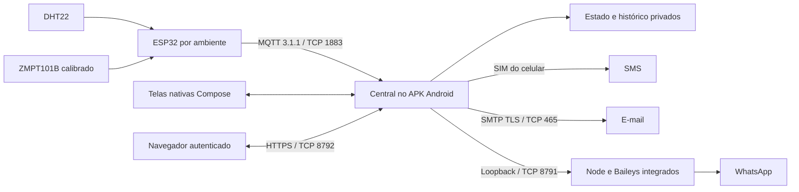

# Winterhold — manual completo da aplicação

**[Baixar o APK Android](https://raw.githubusercontent.com/ThHSzR/winterhold/main/dist/winterhold-demo-debug.apk)** · [Releases](https://github.com/ThHSzR/winterhold/releases) · [Licença MIT](LICENSE) · [Código Android](android/) · [Firmware ESP32](backend/) · [Interface web](web/)

O Winterhold é uma central de monitoramento de **temperatura, umidade e tensão elétrica por ambiente**. Um ESP32 coleta as medidas e as publica por MQTT. Um celular Android recebe as amostras, avalia os limites de cada ambiente, registra eventos, envia notificações e disponibiliza um painel web na rede.

O próprio APK executa a central, o servidor web, o receptor MQTT e, em ARM64, o Node/Baileys usado para WhatsApp. A operação dessa versão não exige Termux, PM2, um broker MQTT separado ou um computador permanentemente ligado. A interface nativa e os navegadores conectados trabalham sobre o estado mantido no celular.

Este manual descreve a implementação presente na `main`, versão Android **`0.7.1`**, código **8**. Os nomes de campos e ações da API são apresentados como aparecem no código. Os exemplos usam endereços e credenciais fictícios.

> **Demonstração também pode enviar mensagens reais.** Ao ativá-la no APK ou na web, você autoriza que violações e normalizações fictícias enviem SMS, e-mail e WhatsApp aos destinatários configurados. As mensagens automáticas recebem `[SIMULADO]`; os testes explícitos recebem `[TESTE SIMULADO]`.

> **Estado da validação:** a central, o runtime integrado até a geração do QR, o acesso HTTPS e os testes de entrega com receptor local foram verificados. O pareamento de uma conta WhatsApp e o envio a um destinatário real ficaram para uma etapa posterior. Leia [validação e limitações](#validacao) antes de interpretar um recurso implementado como uma entrega externa já comprovada.

## Índice

1. [Visão geral e arquitetura](#arquitetura)
2. [Requisitos, instalação e primeiro uso](#instalacao)
3. [Rede, portas e acesso remoto](#rede)
4. [Navegação e estado compartilhado](#navegacao)
5. [Tela Início / Visão geral](#inicio)
6. [Tela Ambientes](#ambientes)
7. [Tela Histórico](#historico)
8. [Tela Alertas e regras de disparo](#alertas)
9. [Tela Equipe e seleção de destinatários](#equipe)
10. [Tela Ajustes](#ajustes)
11. [Modo demonstração, passo a passo](#demonstracao)
12. [SMS, e-mail, WhatsApp e estados de entrega](#entregas)
13. [Usuários, senhas, sessões e segurança](#seguranca)
14. [Serviço Android, bateria e reinicialização](#servico)
15. [Histórico persistente, retenção e atualização](#persistencia)
16. [ESP32, sensores, firmware e MQTT](#esp32)
17. [API HTTP/HTTPS da central](#api)
18. [Prévia web independente](#previa)
19. [Compilação, testes e integração contínua](#desenvolvimento)
20. [Diagnóstico por terminal e ADB](#diagnostico)
21. [Validação, limitações e funcionalidades ausentes](#validacao)
22. [Mapa dos arquivos e responsabilidades internas](#codigo)
23. [Roteiro de operação e glossário](#operacao)

<a id="arquitetura"></a>

## 1. Visão geral e arquitetura

### 1.1. O que cada componente faz

| Componente | Responsabilidade | Onde executa |
| --- | --- | --- |
| ESP32 | Lê DHT22 e sinal analógico do ZMPT101B; monta JSON; publica MQTT. | Microcontrolador de cada ambiente. |
| Central Android | Recebe MQTT; valida medidas; mantém ambientes, contatos e histórico; decide quando gerar alertas. | Processo do APK. |
| Aplicativo nativo | Mostra as telas e configura a central; administra as contas web. | Kotlin / Jetpack Compose no celular. |
| Servidor web | Entrega HTML, CSS e JavaScript e oferece a API autenticada. | Dentro do APK. |
| Navegador | Exibe o estado e envia ações à central. | Celular, tablet ou computador com acesso ao Android. |
| Entregador de alertas | Registra as tentativas; usa SMS, SMTP ou a ponte WhatsApp. | APK, com trabalho de envio em uma fila própria. |
| Ponte Baileys | Mantém a sessão WhatsApp e submete mensagens de texto. | Processo Node privado iniciado pelo APK ARM64; opcionalmente, servidor externo. |



### 1.2. Caminho de uma leitura real

1. O firmware mede temperatura, umidade e tensão.
2. Publica um JSON no tópico `winterhold/DEVICE_ID/leituras`.
3. O receptor MQTT do APK autentica a conexão e valida tópico e conteúdo.
4. A central associa a amostra ao ambiente com aquele `DEVICE_ID`. Se necessário e houver espaço, cria o perfil automaticamente.
5. Registra a hora de recebimento do celular e atualiza o último contato do dispositivo.
6. Guarda a amostra e compara cada medida não nula com o mínimo e o máximo daquele ambiente.
7. Ao detectar uma nova violação ou uma normalização, cria um evento.
8. Para eventos elegíveis, seleciona os destinatários, registra a tentativa e inicia os envios.
9. Atualiza o arquivo de estado. O APK reflete a mudança e a web a obtém na próxima consulta.

Fechar uma aba do navegador não interrompe esse fluxo. Fechar a tela do aplicativo também não deve encerrá-lo: a operação contínua pertence ao serviço Android.

### 1.3. Três situações de uso

| Situação | Fonte das leituras | Persistência | Mensagens externas |
| --- | --- | --- | --- |
| APK em modo real | Publicações MQTT dos ESP32. | No armazenamento privado do Android. | Conforme eventos, filtros, permissões e integrações. |
| APK em demonstração | Cinco ambientes fictícios; alterações manuais e automáticas. | No celular, com históricos separados dos reais. | Podem ocorrer de verdade, com identificação de simulação. |
| Prévia independente em `web/` | Simulação JavaScript no navegador. | Somente memória da página. | Não executa envios. |

O modo de visualização não desliga o receptor MQTT. Se a central estiver ativa, leituras reais podem continuar sendo recebidas, avaliadas e notificadas enquanto a interface mostra a demonstração.

<a id="instalacao"></a>

## 2. Requisitos, instalação e primeiro uso

### 2.1. Requisitos por recurso

| Recurso | Requisitos |
| --- | --- |
| Aplicativo e central | Android 8.0 ou superior, API mínima 26; armazenamento disponível. |
| Runtime WhatsApp integrado distribuído | Aparelho ARM64, ABI `arm64-v8a`; internet para a conexão WhatsApp. |
| Telemetria real | ESP32 com o firmware, sensores e acesso à rede da central. |
| Painel web | Navegador com JavaScript e acesso ao IP do Android; usuário e senha cadastrados no APK. |
| SMS | Hardware de telefonia, SIM e serviço de SMS utilizáveis, permissão `SEND_SMS`. |
| E-mail | Acesso ao servidor SMTP; TLS implícito na porta 465; usuário, senha e remetente. |
| WhatsApp | Runtime ou ponte externa acessível, sessão pareada e número destinatário válido. |
| Funcionamento contínuo | Serviço habilitado, rede disponível e configuração de bateria adequada. |

O projeto foi exercitado em um **Samsung Galaxy A30, SM-A305GT, Android 11/API 30, ARM64**. A API mínima declarada não significa que o conjunto completo tenha sido validado em todos os aparelhos Android 8+.

### 2.2. Instalar

1. Baixe o [APK publicado na `main`](https://raw.githubusercontent.com/ThHSzR/winterhold/main/dist/winterhold-demo-debug.apk).
2. No Android, autorize a instalação pelo aplicativo usado para abrir o arquivo, se o sistema solicitar.
3. Instale e abra **Winterhold**.
4. Conceda a permissão de notificações nos Android que a solicitam.
5. Atenda à solicitação de configuração de bateria para permitir a central em segundo plano.
6. Abra **Ajustes** e confirme a disponibilidade da web e do MQTT.

Também é possível instalar pelo terminal, com depuração USB já autorizada:

```powershell
adb devices -l
adb -s SERIAL_DO_APARELHO install -r .\dist\winterhold-demo-debug.apk
adb -s SERIAL_DO_APARELHO shell am start -W -n br.eng.thsouza.winterhold/.MainActivity
```

Substitua `SERIAL_DO_APARELHO` pela identificação retornada por `adb devices`. O parâmetro `-r` solicita atualização preservando dados, desde que a assinatura e a instalação sejam compatíveis. Se houver erro de assinatura, avalie a migração antes de desinstalar: a remoção do aplicativo apaga os dados privados.

O arquivo distribuído é um APK de **debug**, com assinatura pública de desenvolvimento do repositório. Para distribuição de produção, gere uma versão assinada com sua própria chave privada.

### 2.3. Primeiro acesso web

1. Conecte o celular à rede.
2. Em **Ajustes → Web no celular**, anote ou copie um endereço `https://IP_DO_CELULAR:8792/`.
3. Em **Usuários de acesso web**, veja o login inicial `admin` e a senha gerada, quando ainda exibida. Você pode definir outra senha pelo próprio APK.
4. Confira no APK a impressão **SHA-256 do certificado**.
5. Abra o endereço no navegador e compare a impressão do certificado apresentado com a do aplicativo antes de confiar nele.
6. Entre com o usuário e a senha.
7. Para outras pessoas, crie contas individuais no celular.

A senha inicial não fica disponível para consulta permanente. Se você fechou o processo e não a anotou, redefina-a pelo APK. Não existe senha universal do projeto.

### 2.4. Preparar as leituras reais

1. Em **Ajustes → ESP32 / MQTT**, copie a chave MQTT.
2. Configure Wi-Fi, IP do celular, usuário `winterhold`, chave e `DEVICE_ID` no [arquivo de configuração do firmware](backend/include/config.h).
3. Grave o ESP32.
4. Em **Ambientes**, cadastre o mesmo ID ou aguarde a primeira amostra válida.
5. Personalize nome, ícone e faixas.
6. Fixe o ambiente como favorito para facilitar a seleção no início e na web.
7. Confira o horário da amostra e o estado online.

Para explorar sem ESP32, siga o [roteiro de demonstração](#demonstracao).

<a id="rede"></a>

## 3. Rede, portas e acesso remoto

| Porta TCP | Serviço | Acesso e finalidade |
| --- | --- | --- |
| `8792` | HTTPS da central | Painel e API autenticada na rede. Endereço normal de uso. |
| `8790` | HTTP da central | Arquivos estáticos e `/healthz`; login e API apenas para conexões de loopback. Usada com encaminhamento ADB para diagnóstico. |
| `1883` | Entrada MQTT | ESP32 publica com usuário e chave. Transporte TCP sem TLS nesta implementação. |
| `8791` | Ponte Baileys integrada | Somente `127.0.0.1` no Android; acesso com token. A central intermedeia o acesso do usuário. |
| `8787` | Prévia web de desenvolvimento | Servidor Node opcional no computador; não é a central do APK. |
| `465` | SMTP de saída | Conexão iniciada pelo Android até o servidor de e-mail. Não é uma porta de escuta do APK. |

### 3.1. Descoberta de endereço

O aplicativo lista endereços IPv4 das interfaces de rede, descartando loopback e endereços link-local, com preferência por endereços privados. Mais de um endereço pode aparecer quando existem várias interfaces. Use aquele alcançável a partir do navegador e do ESP32.

O endereço pode mudar quando o roteador renova o DHCP ou o celular troca de rede. Uma reserva DHCP no roteador evita ter de alterar frequentemente `MQTT_HOST`. A aplicação não configura o roteador nem oferece descoberta mDNS nesta versão.

### 3.2. HTTPS e HTTP

O HTTPS utiliza certificado local e chave privada do Android Keystore. O navegador pode exibir um aviso porque o certificado não é emitido por uma autoridade pública. A comparação da impressão SHA-256 com a tela do APK identifica o certificado esperado.

Ao abrir a interface HTTP pela LAN, o JavaScript tenta encaminhar o navegador para HTTPS na porta 8792. Independentemente desse redirecionamento, a API rejeita requisições HTTP vindas da rede com `403`.

O caminho HTTP de loopback existe para diagnóstico. Ele não permite que outro computador autentique diretamente em `http://IP_DO_CELULAR:8790/`; use o encaminhamento ADB descrito neste manual.

### 3.3. Acesso fora da rede

Para acesso remoto, disponibilize o IP do celular por uma VPN configurada na sua infraestrutura. O APK não instala uma VPN nem cria um domínio público. A entrada MQTT TCP usa autenticação, mas não cifra a conexão; mantenha esse tráfego em uma rede protegida.

O servidor não usa `X-Forwarded-For` ou `X-Forwarded-Proto` para transformar uma conexão remota em local ou segura. Um proxy deve respeitar os requisitos HTTPS e de origem da API; simplesmente apontar um proxy HTTP para a porta 8790 não oferece acesso autenticado pela LAN.

<a id="navegacao"></a>

## 4. Navegação e estado compartilhado

### 4.1. Caminhos para as telas

| Tela | Aplicativo Android | Interface web |
| --- | --- | --- |
| Início / Visão geral | Barra inferior: **Início**. | `#inicio`. |
| Ambientes | Barra inferior: **Ambientes**. | `#ambientes`. |
| Alertas | Barra inferior: **Alertas**. | `#alertas`. |
| Histórico | Barra inferior: **Histórico**. | `#historico`. |
| Equipe / Destinatários | Abra **Alertas → Equipe** no topo. | `#equipe`, navegação lateral ou link em Alertas. |
| Ajustes | Ícone de engrenagem no topo. | `#ajustes`. |

A web organiza a navegação para telas largas e estreitas. A barra principal em telas menores prioriza Início, Ambientes, Alertas e Histórico; links complementares levam às demais páginas.

### 4.2. O que é compartilhado

Modo real/demo, ambiente selecionado em cada modo, leituras, eventos, contatos, faixas, favoritos, canais e configurações de integração pertencem à central. Uma alteração feita na web pode aparecer no APK e nos outros navegadores conectados.

Portanto, **a seleção de ambiente e o modo não são preferências privadas de cada navegador**. Duas pessoas podem alterar o foco uma da outra. Já a escolha da variável do gráfico, o filtro visual de alertas e a página aberta são controles locais daquela interface.

A web consulta o estado aproximadamente a cada **5 segundos**. Após uma ação bem-sucedida, usa imediatamente a resposta atualizada. Se perder contato com o APK, mostra erro e tenta restabelecer a conexão; não substitui silenciosamente a central por dados fictícios.

Durante as atualizações de dados, os formulários em edição preservam os valores, o foco e a posição do cursor. Isso inclui senhas ainda não salvas e leituras fictícias. Uma gravação bem-sucedida atualiza o formulário correspondente e limpa os campos de segredo; se a gravação for recusada, o preenchimento é mantido para correção.

### 4.3. Diferenças de capacidade

| Operação | APK | Web autenticada |
| --- | --- | --- |
| Ver leituras, histórico e eventos | Sim. | Sim. |
| Criar/editar ambiente real e suas faixas | Sim. | Sim. |
| Editar ambientes fictícios e leituras demo | Sim. | Sim. |
| Configurar destinatários, filtros e canais | Sim. | Sim. |
| Configurar SMTP e ponte WhatsApp | Sim. | Sim. |
| Consultar estado/QR e solicitar novo pareamento | Sim. | Sim. |
| Consultar chave MQTT | Sim. | Sim. |
| Criar, editar e remover usuários web | Sim. | Não. |
| Redefinir senhas e revogar sessões de um usuário | Sim. | Não. |
| Encerrar a própria sessão web | Não se aplica ao uso nativo. | Sim, por **Sair**. |
| Conceder permissões Android e configurar bateria | Sim, com os diálogos do sistema. | Apenas informa o estado. |
| Parar/retomar o serviço da central | Sim. | Não há controle equivalente exposto. |
| Mostrar saúde de bateria, memória, armazenamento e uptime | Dados fornecidos pelo Android à API. | Cartões na Visão geral. |

<a id="inicio"></a>

## 5. Tela Início / Visão geral

O início resume o **ambiente em foco**, sem misturar leituras de todos os dispositivos em um único gráfico.

### 5.1. Favoritos e seleção

Os ambientes favoritos aparecem como atalhos. Selecione um para mudar as leituras, o histórico e o foco dos eventos recentes. Um ambiente sem favorito continua cadastrado; a estrela apenas controla seu destaque.

No APK, **Ambientes → Ver no início** também seleciona o perfil. Na web, os seletores do início e do histórico mostram os favoritos. Para acessar facilmente um ambiente pela web, fixe-o na página Ambientes e depois selecione seu atalho.

### 5.2. Temperatura e medidas auxiliares

- A temperatura ocupa o cartão principal, com gráfico curto de tendência e horário da amostra mais recente.
- Umidade e tensão aparecem em cartões separados.
- As faixas indicadas pertencem ao ambiente selecionado.
- Uma medida nula é mostrada como `—`; não equivale a zero.
- Sem amostras reais, os cartões aguardam dados. O aplicativo não inventa uma leitura real para preencher a tela.

O gráfico curto da temperatura considera até **18 amostras**. Ele é um resumo visual; a escala se ajusta aos valores disponíveis e não constitui uma linha temporal de duração fixa.

### 5.3. Estados exibidos

| Estado | Significado |
| --- | --- |
| `ONLINE` / Online | Há amostra real recebida dentro da janela de até 15 segundos. |
| `SEM SINAL` / Sem sinal | O ambiente real não tem amostra recente, ou a desconexão demo está ativa. |
| `SIMULANDO` / Simulando | Demonstração com atualização automática habilitada. |
| `PAUSADO` / Pausado | Demonstração sem avanço automático. A edição manual continua disponível. |

O horário recente comprova recepção de amostras, não a calibração do sensor. Um dispositivo pode estar online com uma ou duas medidas nulas, desde que outra medida do JSON seja válida.

### 5.4. Central, eventos recentes e saúde do celular

O painel mostra o vínculo ESP32 → celular e a disponibilidade da central. O início apresenta eventos recentes do contexto selecionado; a tela Alertas reúne os eventos do modo atual.

Na web, **Saúde do celular central** traz:

| Indicador | Origem e interpretação |
| --- | --- |
| Bateria | Percentual informado pelo Android. |
| Memória | Percentual de RAM total ocupado, calculado com memória total e disponível do sistema. |
| Armazenamento | Percentual ocupado na partição de dados do aparelho. |
| Tempo ligado | Tempo desde o boot do Android, incluindo suspensão; não é o tempo da sessão do navegador. |

Essas informações descrevem o telefone que executa a central. O Winterhold não consulta outros serviços do homelab para montar esses cartões.

<a id="ambientes"></a>

## 6. Tela Ambientes

Cada ambiente real é identificado pelo `DEVICE_ID` do firmware. O nome amigável, o ícone e as faixas são configurados na central e não precisam ser gravados no ESP32.

### 6.1. Criar um ambiente real

1. Esteja no modo real, com **Usar leituras fictícias** desligado.
2. Abra **Ambientes → Adicionar ambiente** no APK ou **+ Adicionar** na web.
3. Informe o ID exatamente como no firmware.
4. Escolha um nome e um ícone.
5. Preencha os seis valores de mínimo/máximo.
6. Salve e, se desejar, fixe como favorito.

O ID aceita de **1 a 40 caracteres**, usando letras ASCII, números, `_` e `-`: `[A-Za-z0-9_-]{1,40}`. O nome aceita de **1 a 60 caracteres**, sem espaços sobrando nas extremidades.

Os ícones são `snow`, `classroom`, `lab`, `office` e `server`, representados por símbolos na interface. O ID fica bloqueado no editor de um ambiente existente; mudar o nome não muda o tópico MQTT.

### 6.2. Criação automática

Ao chegar a primeira amostra válida de um ID desconhecido, a central pode criar o ambiente usando o próprio ID como nome. Na configuração inicial, os limites resultantes são:

| Medida | Mínimo inicial | Máximo inicial |
| --- | --- | --- |
| Temperatura | 18 °C | 26 °C |
| Umidade | 30% | 70% |
| Tensão | 198 V | 242 V |

O máximo de temperatura/umidade e o intervalo de tensão da criação automática também consideram os valores globais legados salvos na central. Para estabelecer a regra operacional de um espaço, edite sempre o perfil daquele ambiente.

### 6.3. Validação das faixas

| Medida | Intervalo físico aceito para cada extremo |
| --- | --- |
| Temperatura | −40 a 85 °C. |
| Umidade | 0 a 100%. |
| Tensão | 0 a 300 V. |

Cada valor deve ser finito e o **mínimo precisa ser estritamente menor que o máximo**. Esses intervalos de entrada são validações do software; não substituem especificação e calibração do conjunto de sensores.

Salvar uma faixa não cria uma nova amostra. A comparação ocorre na próxima leitura real, na próxima atualização automática demo ou quando uma leitura demo é aplicada manualmente.

### 6.4. Favoritar, editar e acompanhar

- **Estrela:** fixa ou desafixa o ambiente nos atalhos.
- **Editar limites / Editar:** abre nome, ícone e seis limites.
- **Ver no início**, no APK: muda o ambiente em foco.
- **ONLINE / SEM SINAL:** usa a última recepção daquele ID, independentemente dos demais.

Os cartões priorizam favoritos e ordenam os nomes. Há limite de **32 perfis reais**, mas a entrada MQTT aceita até **8 conexões simultâneas**. Esses dois números representam capacidades diferentes.

Não existe exclusão de ambiente pela interface nesta versão. Usar um novo ID cria outro perfil e consome outra posição; planeje IDs estáveis.

### 6.5. Ambientes na demonstração

O modo demo possui cinco perfis fixos, com nomes, ícones, favoritos e limites editáveis. Não oferece adicionar um sexto ambiente. As faixas e leituras fictícias são separadas das reais. O formulário **Definir leitura / Leitura fictícia** permite aplicar temperatura, umidade e tensão ao perfil escolhido.

<a id="historico"></a>

## 7. Tela Histórico

O histórico mostra as amostras do ambiente selecionado no modo atual, da mais recente para a mais antiga. Você alterna entre **Temperatura**, **Umidade** e **Tensão** sem modificar os dados armazenados.

### 7.1. Quantidades e apresentação

| Item | APK | Web |
| --- | --- | --- |
| Retenção por ambiente | Até 60 amostras. | Usa as mesmas amostras da central. |
| Gráfico da tela Histórico | Até 36 amostras mais recentes. | Todas as amostras retornadas para o ambiente, até 60. |
| Lista/tabela visível | Até 30 amostras mais recentes. | Até 24 amostras mais recentes. |
| Seleção de variável | Filtros no topo. | Botões de temperatura, umidade e tensão. |
| Persistência | Arquivo privado do Android. | Não cria outro banco no navegador. |

O total mostrado pode ser maior que a quantidade de linhas visíveis porque a lista é um recorte do histórico retido.

### 7.2. Como interpretar tempo e gráfico

A retenção é por **quantidade**, não por dias. Com o firmware publicando a cada segundo, 60 amostras representam aproximadamente o último minuto de recepção contínua. Em demo com atualização a cada 5 segundos, representam aproximadamente 5 minutos após o preenchimento da janela. Interrupções e alterações manuais mudam essa relação.

O relógio da central Android marca as amostras reais. O `timestamp` enviado pelo firmware não define a ordenação do histórico. A apresentação de data/hora usa a configuração temporal de cada interface.

Os gráficos eliminam valores nulos antes de desenhar a linha e distribuem os pontos por posição. Assim, uma linha contínua pode atravessar uma lacuna de medição; ela não comprova que houve uma amostra válida em cada instante intermediário.

Nesta versão não há filtro por data, paginação completa, exportação CSV/PDF ou armazenamento de longo prazo pela interface.

<a id="alertas"></a>

## 8. Tela Alertas e regras de disparo

### 8.1. O que aparece em um evento

Um evento contém ID próprio, horário, título, descrição, severidade, estado aberto/resolvido, indicação real/demo e, quando associado, ID do ambiente. Os cartões apresentam essas informações e os controles **Ver entregas** e **Marcar resolvido**.

Os filtros **Todos**, **Abertos** e **Resolvidos** afetam apenas a lista. A tela mostra eventos do modo atual: reais no modo real, simulados no demo. Ela reúne os ambientes daquele modo; selecionar um ambiente no início não restringe toda a lista de Alertas a esse único ID.

### 8.2. Comparação com os limites

Para cada variável com valor válido, a central executa a seguinte regra:

| Comparação | Resultado |
| --- | --- |
| `valor < mínimo` | Violação abaixo do mínimo. |
| `mínimo ≤ valor ≤ máximo` | Dentro da faixa. |
| `valor > máximo` | Violação acima do máximo. |
| `valor = null` | Não avalia essa variável nessa amostra. |

Os extremos pertencem à faixa normal. Se o máximo é 26 °C, exatamente 26 °C não viola a regra; 26,1 °C viola.

Não existe temporização de permanência, média móvel, histerese ou exigência de várias amostras seguidas para iniciar uma ocorrência. Uma amostra válida fora da faixa pode disparar imediatamente. Pequenas oscilações atravessando repetidamente o limite podem, portanto, produzir novas violações e normalizações.

### 8.3. Severidades

| Condição | Severidade |
| --- | --- |
| Temperatura fora da faixa | `warning` — aviso. |
| Umidade fora da faixa | `warning` — aviso. |
| Tensão fora da faixa | `critical` — crítico. |
| Dispositivo sem comunicação | `critical`. |
| Medida normalizada | `info`, com evento já resolvido. |
| Comunicação restabelecida | `info`, com evento já resolvido. |

Essas classificações são definidas pelo código. A interface não permite personalizar a severidade de cada regra.

### 8.4. Como evita repetição

A central acompanha a condição por **modo real/simulado + ambiente + variável + lado da faixa**. Temperatura alta na Sala 01 é independente de temperatura alta no Laboratório 02, e também de temperatura baixa na própria Sala 01.

Exemplo com faixa de temperatura de 19 a 26 °C:

| Sequência | Leitura | Efeito |
| --- | --- | --- |
| 1 | 24 °C | Dentro da faixa; nenhum novo alerta. |
| 2 | 28 °C | Abre uma ocorrência de temperatura acima do máximo. |
| 3 | 29 °C | Continua a mesma condição; não repete o envio a cada leitura. |
| 4 | 27 °C | Continua a mesma condição. |
| 5 | 25 °C | Resolve a ocorrência aberta e registra temperatura normalizada. |
| 6 | 28 °C | Nova violação após normalização; pode gerar novo envio. |
| 7 | 17 °C | Muda diretamente de acima do máximo para abaixo do mínimo; encerra a ocorrência anterior e abre a do outro lado. |

A mudança direta entre lados não cria uma normalização intermediária, pois nenhuma amostra normal foi recebida.

Uma leitura nula não resolve uma violação anterior. A condição só é reavaliada quando chega outro valor válido para aquela variável.

### 8.5. Marcar resolvido

**Marcar resolvido** registra o reconhecimento visual do evento. Não altera sensores, limites ou destinatários e não prova que o ambiente voltou à faixa.

Se você reconhecer uma temperatura alta e ela continuar alta, a central não deve enviar outra mensagem por causa desse reconhecimento. O controle da condição ativa é separado do estado visual do evento e é persistido para manter esse comportamento após reinício.

### 8.6. Ausência de comunicação

A central verifica periodicamente os IDs que já enviaram amostras. Após **mais de 15 segundos** sem leitura, registra uma ocorrência de dispositivo sem comunicação. Como a verificação periódica ocorre a cada 5 segundos, o registro depende do próximo ciclo após o vencimento dessa janela.

Quando chega uma amostra do dispositivo desconectado, registra comunicação restabelecida. Um perfil cadastrado manualmente que nunca publicou aparece sem sinal, mas não produz o mesmo evento por tempo sem leitura até passar a ter registro de recepção.

A recuperação de comunicação é um registro informativo. O entregador atual envia violações e normalizações de medidas, mas filtra os demais eventos `info`; portanto, **comunicação restabelecida não gera envio externo automático**. O cartão antigo de desconexão também não é necessariamente marcado resolvido por esse evento: você pode reconhecê-lo manualmente.

### 8.7. Ver entregas

Abra **Ver entregas** para inspecionar destinatário, canal, destino registrado e estado. A lista de rotas é montada com os filtros atuais dos contatos; uma mudança posterior nesses filtros pode alterar o que aparece para um evento antigo. A API também limita a quantidade de registros de entrega retornados por consulta.

Na versão atual, o diálogo nativo ainda pode exibir a frase antiga **“Evento simulado: sem envio.”** para um evento demo automático. Essa frase não representa a regra implementada na versão 0.7: violações e normalizações demo elegíveis passam pelo entregador real. Confira o estado de cada canal e a [descrição dos estados](#entregas).

### 8.8. Testes explícitos

Em modo demo, a tela oferece testes para temperatura, umidade e tensão. Cada acionamento cria um evento **Teste de…** e solicita o envio aos destinatários compatíveis, com `[TESTE SIMULADO]`.

O teste não precisa que a medida esteja fora da faixa e não modifica a leitura. Cada novo acionamento cria um ID de evento diferente, portanto pode enviar outra mensagem. Para testar o motor de limites, aplique uma leitura fictícia em Ambientes, conforme o roteiro abaixo.

<a id="equipe"></a>

## 9. Tela Equipe e seleção de destinatários

Um destinatário é um perfil de entrega com nome, função, telefone, e-mail, conjunto de variáveis, conjunto de canais e estado ativo/inativo. Ele não é uma conta de login web.

### 9.1. Perfis iniciais

| Perfil | Variáveis iniciais | Canais iniciais |
| --- | --- | --- |
| Equipe de manutenção | Temperatura, umidade e tensão. | SMS e WhatsApp. |
| Técnico elétrico | Tensão. | SMS. |
| Gestão de instalações | Temperatura e umidade. | E-mail e WhatsApp. |

Os perfis iniciais não possuem telefone/e-mail reais. A presença do cartão não significa que o envio esteja configurado.

### 9.2. Adicionar e configurar

1. No APK, abra **Alertas → Equipe → Adicionar destinatário**. Na web, abra **Equipe → Novo perfil**.
2. Informe nome e função. Uma função vazia assume **Equipe**.
3. O perfil começa ativo, com todas as variáveis e canal SMS.
4. Abra **Editar filtros** ou **Editar destinos e filtros**.
5. Preencha telefone e e-mail e acione **Salvar destinos**.
6. Habilite apenas as variáveis e os canais desejados.
7. Confira também os canais globais em Ajustes.

O telefone deve estar no formato internacional **E.164**, começando por `+`, sem espaços, parênteses ou hífens. Exemplo de formato: `+5511999999999`. O mesmo campo atende SMS e WhatsApp. O e-mail passa por validação de formato; isso não verifica a existência da caixa postal.

### 9.3. Regra de roteamento

Um envio externo é considerado para um contato quando:

1. O contato está ativo.
2. A variável do evento pertence às variáveis selecionadas no contato. Eventos sem variável, como desconexão, consideram todos os contatos ativos.
3. O canal pertence aos canais do contato **e** aos canais globais habilitados.
4. Há destino preenchido e configuração/permissão suficiente para tentar aquele canal.

Não há filtro de destinatários por ambiente nesta versão. Um técnico inscrito em tensão pode receber eventos de tensão de qualquer ambiente. Os filtros disponíveis são por variável, canal e ativação do perfil.

Exemplo: manutenção com temperatura + SMS/WhatsApp, técnico com tensão + SMS e gestão com temperatura + e-mail. Uma violação de temperatura seleciona manutenção e gestão; não seleciona o técnico elétrico. Se WhatsApp estiver globalmente desligado, a manutenção fica apenas com SMS.

### 9.4. Desativação e ausência de rota

Desativar o perfil preserva os dados e o retira das próximas seleções. Desligar todos os canais ou retirar todas as variáveis de um evento também pode deixar o contato sem rota.

Não existe exclusão nem edição de nome/função de contatos já criados pela interface atual. Use a desativação para retirar um perfil de operação. Contatos diferentes com o mesmo telefone são identidades de entrega diferentes: podem produzir mensagens duplicadas para a mesma pessoa, pois a deduplicação usa o ID do contato.

Alterar os contatos depois de um evento não reenvia esse evento. A seleção e a reserva são feitas quando o evento novo é processado.

<a id="ajustes"></a>

## 10. Tela Ajustes

### 10.1. Web no celular / Central e acesso

Mostra estado da central e endereços web. No APK, **Copiar endereço** envia a URL para a área de transferência; **Parar central** encerra os servidores e o processo integrado; **Retomar central** inicia novamente. **Configurar bateria** abre o ajuste Android correspondente.

A web informa os endereços e o estado de permissões/bateria, mas não concede permissões nem para o serviço. Alguns textos de status nativos ainda citam HTTP/porta 8790: para uso pela rede, o endereço correto desta versão é **HTTPS 8792**.

### 10.2. Usuários de acesso web — somente APK

Permite ver contas, criar nome/login/senha, alterar nome/login, definir outra senha, ativar/desativar, excluir e revogar sessões. Também exibe a impressão do certificado e, quando disponível, a senha inicial. As regras completas estão em [segurança](#seguranca).

### 10.3. Modo demonstração

- **Usar leituras fictícias:** solicita confirmação sobre mensagens reais e alterna o contexto de operação.
- **Atualização automática:** avança leituras dos cinco perfis a cada ciclo de simulação.
- **Simular desconexão:** interrompe o avanço automático e registra a condição simulada.

Esses dois últimos controles aparecem no contexto demo. Retornar ao modo real preserva o histórico fictício. Após restauração do processo, o aplicativo inicia em modo real e com a simulação pausada.

### 10.4. ESP32 / MQTT

Mostra disponibilidade da entrada MQTT, porta 1883, usuário `winterhold` e chave gerada no aparelho. No APK há **Copiar chave MQTT**. A web autenticada também recebe e mostra essa chave; trate uma conta web como acesso à configuração da central.

Não há formulário de troca de porta ou rotação da chave MQTT pela interface nesta versão. Alterar somente o nome de um ambiente não exige trocar a chave ou regravar o ESP32.

### 10.5. Canais de alerta

Os interruptores SMS, E-mail e WhatsApp são habilitações globais. Eles se combinam com os filtros de cada destinatário. Não dispensam telefone, e-mail, permissões, credenciais ou pareamento.

No APK, quando necessário, **Permitir envio de SMS neste aparelho** solicita `SEND_SMS`. Na web, o estado aparece para consulta; a concessão ocorre no telefone.

### 10.6. E-mail / SMTP TLS

| Campo | Como preencher |
| --- | --- |
| Servidor SMTP | Host do servidor, sem `https://` e sem `:465`. A porta é fixa no código. |
| Usuário | Login aceito pelo provedor SMTP. |
| Remetente | Endereço de e-mail autorizado a enviar. |
| Senha / senha de aplicativo | Segredo exigido pelo provedor para autenticação SMTP. |

**Salvar SMTP** no APK ou **Salvar integrações** na web guarda a configuração no celular. Deixar a senha vazia conserva a anterior. O campo não retorna preenchido com o segredo salvo.

O formulário web reúne SMTP e ponte WhatsApp na mesma ação. Ao usá-lo por uma integração própria, envie também os valores públicos que deseja preservar; a ação não é uma atualização parcial genérica de todos os campos.

### 10.7. WhatsApp / ponte Baileys

Mostra o estado do runtime e o estado da conexão. Em ARM64, a configuração inicial aponta para `http://127.0.0.1:8791`, com token aleatório guardado pela central.

No APK, o painel consulta conexão e QR aproximadamente a cada 5 segundos enquanto está aberto. Na web, use **Ver conexão e QR do WhatsApp**; consulte novamente se precisar atualizar o QR.

**Novo pareamento** pede confirmação, encerra a sessão local atual, arquiva os arquivos de autenticação anteriores e solicita uma nova conexão. A geração de um QR não comprova que houve pareamento.

Os campos **URL da ponte** e **Chave da ponte** permitem configurar a alternativa externa. Token vazio conserva o atual. Use uma URL base, sem caminho de endpoint, usuário embutido, query ou fragmento. O aplicativo acrescenta `/send`, `/status` ou `/relink` conforme a operação. URLs remotas devem usar HTTPS; HTTP é aceito apenas com host `127.0.0.1` ou `localhost`.

<a id="demonstracao"></a>

## 11. Modo demonstração, passo a passo

### 11.1. Cinco espaços independentes

| ID fixo | Nome inicial | Temperatura | Umidade | Tensão | Favorito inicial |
| --- | --- | --- | --- | --- | --- |
| `demo_sala01` | Sala de aula 01 | 19–26 °C | 35–65% | 198–242 V | Sim. |
| `demo_lab02` | Laboratório 02 | 20–24 °C | 40–60% | 205–235 V | Sim. |
| `demo_servidores` | Sala de servidores | 17–22 °C | 30–55% | 208–232 V | Não. |
| `demo_adm` | Administração | 21–28 °C | 35–70% | 200–240 V | Não. |
| `demo_auditorio` | Auditório | 18–25 °C | 30–68% | 198–242 V | Não. |

Esses são os valores iniciais; as edições ficam salvas. O estado inicial inclui amostras e eventos fictícios para preencher a apresentação. Eles não representam medições anteriores do seu equipamento e não são reproduzidos como envios ao iniciar a central.

### 11.2. Ativar e controlar

1. Confira os destinos reais em Equipe e os canais globais.
2. Abra **Ajustes → Modo demonstração**.
3. Ligue **Usar leituras fictícias**.
4. Leia e confirme que condições fictícias podem enviar mensagens reais.
5. A simulação automática começa habilitada. Desligue **Atualização automática** para um ensaio manual controlado.
6. Escolha o perfil em Ambientes ou pelos favoritos.

O avanço automático altera suavemente as três medidas de **todos os cinco ambientes**, a cada 5 segundos. Não se limita ao ambiente aberto na tela. Perfis inicialmente fora das próprias faixas podem produzir alertas assim que forem avaliados.

### 11.3. Testar uma violação manual

Exemplo para Sala de aula 01, supondo que seus limites ainda sejam os iniciais:

1. Pause a atualização automática.
2. Em Ambientes, selecione Sala de aula 01.
3. Aplique **24 °C, 50%, 220 V**, para estabelecer uma condição normal.
4. Aplique **28 °C, 50%, 220 V**.
5. Abra Alertas: deve existir uma ocorrência simulada de temperatura acima do máximo.
6. Em Ver entregas, examine as rotas e os estados. A tentativa automática não exige o botão Testar.
7. Aplique **29 °C, 50%, 220 V**: a mesma violação não deve repetir o envio.
8. Aplique **24 °C, 50%, 220 V**: deve haver normalização elegível para notificação.
9. Aplique **28 °C, 50%, 220 V** novamente: uma nova ocorrência pode enviar.

No APK, os campos numéricos aceitam vírgula convertida para ponto. Na API, os números JSON usam ponto decimal. Leituras manuais devem ter as três medidas finitas, dentro dos intervalos físicos aceitos.

### 11.4. Simular desconexão e encerrar

**Simular desconexão** registra um evento sem variável para o ambiente demo selecionado e suspende o avanço automático de todos os perfis enquanto a opção estiver ligada. Isso não desliga o Wi-Fi do telefone nem derruba as conexões reais dos ESP32.

A aplicação manual de uma leitura demo continua sendo uma ação possível mesmo com a simulação automática pausada ou a desconexão fictícia ligada. Esses controles são diferentes de parar o serviço da central.

Para encerrar o ensaio, desligue **Usar leituras fictícias**. O modo real volta a mostrar os ESP32. Se o processo for reiniciado, o demo fica pausado e precisa ser reativado pelo operador.

<a id="entregas"></a>

## 12. SMS, e-mail, WhatsApp e estados de entrega

### 12.1. Notificação local do Android

O APK mantém um canal de notificações da central e outro para alertas de ambientes. Um evento elegível pode gerar notificação local mesmo sem contato externo configurado. Nos Android 13+, isso depende da permissão de notificações e das configurações do sistema.

Uma notificação local não comprova envio de SMS, e-mail ou WhatsApp. Os caminhos são registrados separadamente.

### 12.2. SMS

O aplicativo usa o serviço de SMS do Android e o SIM do aparelho. É necessário conceder `SEND_SMS`, ter suporte a mensagens e um serviço de operadora utilizável. Não é um gateway SMS na nuvem.

Mensagens longas são divididas em partes. O estado fica `queued` durante o processamento e passa a `submitted` quando os retornos de submissão das partes indicam sucesso. O projeto não solicita comprovantes de entrega final ao destinatário nem oferece seleção de SIM na interface.

### 12.3. E-mail

O cliente SMTP abre uma conexão TLS diretamente na **porta 465**, valida o certificado/hostname do servidor, faz `EHLO`, autentica com `AUTH LOGIN` e envia uma mensagem de texto UTF-8.

Não há escolha de porta, STARTTLS na 587, OAuth SMTP, anexos ou templates HTML nesta versão. Use credenciais compatíveis com o método implementado. Um servidor que aceite a submissão ainda pode encaminhar a mensagem para spam, rejeitá-la posteriormente ou gerar um retorno fora do aplicativo.

### 12.4. WhatsApp integrado: funcionamento

O APK ARM64 inclui **Node 24.18.0** e **Baileys 6.7.24**, com dependências fixadas em lockfiles. O build prepara dez arquivos ELF e empacota os módulos JavaScript, certificados CA e avisos de licenças.

Ao iniciar a central, o APK:

1. Localiza o executável instalado no diretório de bibliotecas nativas do próprio aplicativo.
2. Extrai os módulos para o diretório privado `files/bridge-runtime` quando a versão/instalação mudou.
3. Prepara ambiente próprio, diretórios privados, CAs e token.
4. Inicia o Node com `server.js`, escutando somente loopback.
5. Mantém a autenticação WhatsApp em `files/whatsapp-session`, separada dos módulos substituídos na atualização.
6. Supervisiona o processo e tenta iniciá-lo novamente após interrupção, enquanto a central estiver habilitada.

Os binários usados no build têm origem em pacotes Android do projeto Termux, fixados por SHA-256. Isso não significa dependência do aplicativo Termux no telefone: o executável e suas bibliotecas são incluídos no APK e executam sob o usuário do Winterhold.

Em outra ABI sem runtime preparado, a central informa que o runtime integrado está indisponível e permite configurar uma ponte HTTPS externa. Um APK que só contenha bibliotecas ARM64 também pode ser recusado pelo instalador de um aparelho incompatível; o fallback de software não garante instalação de qualquer artefato em qualquer ABI.

### 12.5. Parear a conta

1. Mantenha a central e a internet disponíveis.
2. Abra Ajustes → WhatsApp no APK ou na web autenticada.
3. Aguarde o estado de pareamento e consulte o QR atual.
4. No telefone da conta remetente, abra a área de aparelhos conectados do WhatsApp e leia esse QR.
5. Aguarde `connected`.
6. Cadastre o telefone destinatário em Equipe e habilite a variável/canal.
7. Faça um teste explícito e confira a mensagem no destino.

Essa confirmação depende do proprietário da conta. QR gerado, processo iniciado e token configurado são condições diferentes de sessão pareada e mensagem recebida.

| Estado da ponte | Significado |
| --- | --- |
| `starting` | Inicializando a conexão. |
| `pairing` | Há QR para vincular a conta. |
| `connected` | A sessão está conectada. |
| `disconnected` | A conexão foi encerrada; pode haver tentativa agendada. |
| `reconnecting` | Tentando recuperar a conexão após falha. |
| `logged_out` | Sessão deslogada; requer intervenção e novo pareamento. |

As reconexões usam espera progressiva, chegando a 60 segundos em fechamentos recuperáveis. Falhas de inicialização podem tentar novamente em 10 segundos. O texto “Baileys integrado iniciado” descreve o processo; consulte o estado da sessão para saber se o WhatsApp está conectado.

### 12.6. Ponte externa opcional

O mesmo [servidor Node/Baileys](backend/whatsapp/server.js) pode executar em outro host. Nesse caso, o APK continua sendo a central e apenas entrega mensagens à ponte.

| Variável de ambiente | Uso |
| --- | --- |
| `WINTERHOLD_BRIDGE_TOKEN` | Obrigatória; ao menos 32 caracteres; deve corresponder ao token configurado no APK. |
| `WINTERHOLD_BRIDGE_HOST` | Host de escuta; padrão `127.0.0.1`. |
| `WINTERHOLD_BRIDGE_PORT` | Porta; padrão `8791`. |
| `WINTERHOLD_BRIDGE_DATA` | Diretório persistente privado; padrão `./private-session`. |
| `WINTERHOLD_ANDROID_PARENT` | Watchdog usado pelo APK; não é necessário na hospedagem externa. |

Instale as dependências com `npm ci --omit=optional --ignore-scripts` em `backend/whatsapp` e execute `npm start` no ambiente configurado. Para acesso de outro host, disponibilize a ponte por HTTPS e proteja seu diretório de sessão. Veja o [guia da ponte](backend/whatsapp/README.md).

### 12.7. Reserva e prevenção de duplicidade

Cada tentativa externa possui uma chave **ID do evento + ID do contato + canal**. A central grava a reserva antes de chamar o canal. A ponte WhatsApp também mantém uma reserva em disco antes de submeter a mensagem.

Não existe reenvio automático de uma tentativa reservada, bloqueada ou incerta. Essa escolha reduz duplicidade após quedas, mas permite que uma ocorrência fique sem mensagem quando houver falha. Corrigir a configuração não reproduz automaticamente o histórico: use um teste explícito ou aguarde uma nova transição válida.

Ao iniciar o processo, os eventos já carregados são marcados como conhecidos e não são reenviados. Normalizações novas são processadas como novos eventos elegíveis; recuperações informativas de comunicação são apenas registradas.

### 12.8. Estados de uma entrega

| Estado | Interpretação | Próximo passo |
| --- | --- | --- |
| `reserved` | Tentativa registrada antes do efeito externo; pode estar na fila ou ter sido interrompida. | Verificar o canal antes de repetir. |
| `queued` | SMS entregue à fila de envio do Android, aguardando retornos das partes. | Conferir SIM/operadora e aguardar o processamento. |
| `submitted` | O canal/provedor aceitou a submissão. | Confirmar recebimento no destinatário quando necessário. |
| `blocked: destino ausente` | O contato foi selecionado, mas falta telefone ou e-mail. | Preencher o destino. |
| `blocked: configure SMTP` | Faltam campos necessários ao SMTP. | Completar a configuração de e-mail. |
| `blocked: permissão SMS ausente` | O Android não autorizou SMS. | Conceder a permissão no telefone. |
| `blocked: configure WhatsApp` | Falta URL ou token da ponte. | Configurar a integração. |
| `failed: …` | Falha registrada no caminho SMS. | Conferir a causa antes de um novo teste. |
| `uncertain` | O caminho e-mail/WhatsApp lançou erro; a central não comprova a conclusão. | Conferir o provedor/destino antes de repetir. |
| Sem registro / “aguardando configuração” | Não há tentativa disponível para aquela combinação na consulta atual. | Conferir elegibilidade, filtros, configuração e contexto. |

`submitted` não equivale a entregue ou lido. Não há sincronização de recibos de leitura do WhatsApp nem confirmação final unificada dos três canais.

O `smtpConfigured` da API indica presença de senha salva e `bridgeConfigured` indica presença de token. Esses indicadores não testam autenticação SMTP, conectividade, pareamento ou entrega.

<a id="seguranca"></a>

## 13. Usuários, senhas, sessões e segurança

### 13.1. Administração exclusivamente no APK

Em Ajustes → Usuários de acesso web, cada conta possui nome, login e estado ativo/inativo. A senha pode ser definida novamente, mas não recuperada em texto.

| Regra | Valor |
| --- | --- |
| Quantidade de contas | Até 16. |
| Nome | 1 a 60 caracteres após remover espaços externos. |
| Login | 3 a 40 caracteres: letras ASCII, números, `_`, `.` e `-`. |
| Normalização do login | Remoção de espaços externos e conversão para minúsculas. |
| Login duplicado | Rejeitado após normalização. |
| Nova senha | 12 a 256 caracteres. |
| Último usuário ativo | Não pode ser desativado ou excluído. |

**Salvar usuário / senha** altera nome/login e, se o campo estiver preenchido, define outra senha. Senha vazia nesse formulário não apaga a atual. **Revogar sessões** derruba as sessões daquele usuário sem exigir trocar sua senha.

Editar a conta, redefinir senha, ativar/desativar ou excluir também revoga suas sessões. O navegador volta a exigir login na próxima chamada autenticada.

Não há papéis separados de leitor e administrador: todas as contas web autenticadas acessam as configurações operacionais oferecidas pela API. O nome `admin` é o login inicial; não representa um sistema de permissões por função. A administração das próprias contas continua restrita ao APK.

### 13.2. Armazenamento de senha e sessão

As senhas são derivadas com **PBKDF2-HMAC-SHA256**, **210.000 iterações**, salt aleatório individual e resultado de 256 bits. A verificação usa comparação apropriada dos hashes; a API não devolve senha, salt ou hash de conta.

Após login, o servidor gera um token de sessão aleatório e o envia em cookie:

- Nome `winterhold_session` e caminho `/`.
- `HttpOnly`, para impedir acesso direto pelo JavaScript da página.
- `SameSite=Strict`.
- `Secure` quando a conexão é HTTPS.
- Validade de **8 horas**, contada a partir da criação.

As sessões ficam na memória do processo, com até 128 registros. Reiniciar o processo Android exige novo login; reiniciar apenas a página não elimina automaticamente uma sessão ainda válida. **Sair** revoga o token atual e expira o cookie.

### 13.3. Limitação de tentativas e requisições

O login tem uma janela de 60 segundos com limite por endereço de origem e global. O código bloqueia novas tentativas após atingir 5 no endereço ou 30 no contador global da janela; o sucesso limpa o contador daquele endereço, mas não o global. O retorno de bloqueio é `429`.

Requisições POST da API exigem `X-Winterhold-Request: 1`. Se houver cabeçalho `Origin`, ele precisa corresponder ao esquema e ao host da requisição. O servidor não habilita CORS para outros sites.

Login e ações aceitam corpos com `Content-Length` de 1 a 8192 bytes, sem transferência chunked. São medidas específicas dessa implementação, não um substituto para controlar quem acessa a rede/aparelho.

### 13.4. Certificado e segredos de integração

A chave privada TLS EC P-256 é criada no Android Keystore e não é exportada pela aplicação. O certificado local pode ser identificado pela impressão SHA-256 exibida no APK.

Senha SMTP e token da ponte são cifrados com AES-GCM usando uma chave no Android Keystore. Campos públicos, como host SMTP e URL da ponte, ficam nas preferências. A sessão Baileys usa arquivos privados de autenticação; não se trata do mesmo mecanismo de hash usado para senhas web.

O estado autenticado expõe os destinos dos contatos e a chave MQTT, pois a web permite configurar a operação. Portanto, não compartilhe contas web com pessoas que devam ter acesso apenas a um gráfico.

### 13.5. Migração de acesso antigo por chave

Ao atualizar um estado antigo com contas baseadas em chave, cada conta passa a ter login `usuario1`, `usuario2` e assim por diante, visível no APK. A chave anterior é convertida em hash e pode servir como senha temporária por **sete dias** após a migração. O texto antigo é removido das preferências.

Redefina uma senha permanente no APK dentro desse período. Se a senha temporária expirar, o proprietário ainda pode redefinir pelo telefone. Há também tratamento para o formato antigo que possuía apenas um segredo inicial, convertido em conta `admin`.

<a id="servico"></a>

## 14. Serviço Android, bateria e reinicialização

### 14.1. Inicialização e operação contínua

Abrir a atividade principal habilita e inicia o `CentralService`. O serviço mostra uma notificação persistente, mantém bloqueios de CPU/Wi-Fi durante a operação e verifica a central aproximadamente a cada **10 segundos**.

O ciclo de leituras demo, heartbeat, entrega de novos eventos e atualização dos endereços ocorre aproximadamente a cada **5 segundos** enquanto a central está ativa. Recepção MQTT e ações manuais também podem atualizar o estado fora desse ciclo.

O serviço é independente da tela e declara `START_STICKY` para permitir retomada após encerramentos recuperáveis pelo Android. Isso não elimina restrições do fabricante, economia de energia, falta de memória ou indisponibilidade de rede.

### 14.2. Parar e retomar

**Parar central**, nos Ajustes ou na notificação do serviço, desabilita a operação, fecha HTTP/HTTPS/MQTT e interrompe o Node integrado. Os dados já salvos permanecem.

Para voltar, use **Retomar central** no APK. Abrir novamente a atividade principal também solicita habilitação/inicialização. Não há endpoint web para recuperar um servidor que foi parado no telefone.

### 14.3. Boot, atualização e parada forçada

| Situação | Comportamento esperado |
| --- | --- |
| Tela fechada ou atividade encerrada | Serviço continua se o sistema permitir. |
| Processo encerrado de forma recuperável | Android pode reiniciar o serviço; runtime é preparado novamente. |
| Reinício do aparelho | Receiver de boot tenta iniciar se a central estava habilitada; pode depender de desbloqueio e políticas do sistema. |
| APK atualizado com assinatura compatível | Receiver de substituição tenta retomar se habilitado; dados privados permanecem. |
| Central parada pelo botão | Flag de habilitação fica desligada; boot não deve reativá-la sozinho. |
| Parada forçada nas configurações / `am force-stop` | É necessário reabrir o aplicativo para voltar à operação normal. |

O processo Node verifica o vínculo com o processo Android a cada 2 segundos e encerra se perder o pai esperado. O serviço tenta recuperar um runtime interrompido, respeitando um intervalo mínimo entre tentativas de início.

### 14.4. Permissões e consequências

| Permissão/capacidade | Finalidade |
| --- | --- |
| Internet | Servidores locais e integrações de rede. |
| Serviço em primeiro plano / uso especial | Manter a central visível ao sistema durante a operação. |
| Receber boot | Tentar retomar uma central habilitada após reinício. |
| Notificações | Exibir avisos ao operador, conforme versão Android e configurações. |
| SMS | Enviar pelo SIM do aparelho. É solicitada separadamente. |
| Wake lock e estado Wi-Fi | Apoiar operação contínua do serviço. |
| Exceção de otimização de bateria | Reduzir interrupções por economia de energia. |

A aplicação não exige permissão de câmera para mostrar o QR. Quem lê o código é o telefone da conta WhatsApp. A web não pode conceder permissões do Android.

<a id="persistencia"></a>

## 15. Histórico persistente, retenção e atualização

### 15.1. Onde os dados ficam

| Conjunto | Local lógico privado |
| --- | --- |
| Ambientes, amostras reais/demo, eventos, destinatários e canais | `files/demo-state.json`, com gravação por `AtomicFile`. |
| Contas web e hashes de senha | Preferências `web_access`, formato `accounts_v2`. |
| Chave MQTT | Preferências `mqtt`. |
| Flag da central habilitada | Preferências `central`. |
| Configuração SMTP/ponte e segredos cifrados | Preferências `delivery_settings` e chaves no Android Keystore. |
| Reservas, destinos e estados de tentativas | Preferências `alert_delivery`. |
| Módulos Node extraídos | `files/bridge-runtime`. |
| Autenticação e reservas da ponte WhatsApp | `files/whatsapp-session`, incluindo `auth` e `reserved.json`. |

Os nomes são relativos ao armazenamento privado do pacote `br.eng.thsouza.winterhold`. Não são pastas públicas que o navegador pode baixar.

### 15.2. Limites de retenção

| Dado | Limite implementado |
| --- | --- |
| Ambientes reais | 32. |
| Leituras reais | 60 por dispositivo; até 1.920 no conjunto. |
| Ambientes demo | 5. |
| Leituras demo | 60 por perfil; até 300 no conjunto. |
| Eventos persistidos | Os 500 primeiros da lista atual, que é ordenada por inserção recente nos fluxos normais. |
| Entregas na resposta `/api/v1/state` | Até 100 registros. |
| Contas web | 16. |
| Conexões MQTT simultâneas | 8. |

O limite de eventos não é uma política completa de expiração de todos os arquivos. O registro de tentativas e as reservas da ponte não possuem limpeza periódica equivalente implementada. Não trate esse armazenamento como um banco de auditoria ilimitado.

### 15.3. Restauração e falhas

O estado é serializado em JSON versão 5 e o restaurador aceita formatos anteriores de 1 a 5. O conteúdo é decodificado e validado antes de substituir os dados em memória. Se o arquivo não puder ser restaurado, a central registra erro e usa valores iniciais.

Na restauração, preserva ambientes, leituras, eventos, contatos, canais e condições de violação salvas. O modo volta para real; atualização automática demo e desconexão simulada começam desligadas. As sessões web, por estarem apenas em memória, não sobrevivem ao reinício do processo.

As gravações de estado são assíncronas em uma fila e usam escrita atômica. Isso reduz o risco de um JSON parcialmente gravado, mas uma interrupção pode ocorrer antes da persistência da alteração mais recente.

### 15.4. Atualizar, limpar dados e migrar aparelho

Atualizações com a mesma assinatura normalmente preservam o armazenamento privado. Os módulos da ponte são atualizados separadamente da sessão WhatsApp. Versões assinadas com outra chave não substituem diretamente a instalação existente.

**Limpar dados** ou **desinstalar** remove histórico, contas, configuração, chaves e sessão local. O manifesto desabilita backup Android automático e a interface não oferece exportação/importação de backup completo.

Copiar preferências cifradas para outro aparelho não garante recuperar os segredos, pois dependem das chaves do Keystore original. Planeje reconfiguração de integrações e novo pareamento numa troca de telefone.

<a id="esp32"></a>

## 16. ESP32, sensores, firmware e MQTT

### 16.1. Hardware previsto e pinagem

O firmware usa a placa `esp32dev` do PlatformIO com framework Arduino, sensor **DHT22** e módulo de medição **ZMPT101B**.

| Parâmetro | Padrão no código |
| --- | --- |
| Dados do DHT22 | GPIO 4, `DHT_PIN`. |
| Entrada analógica do ZMPT101B | GPIO 34, `ZMPT_PIN`. |
| Resolução ADC | 12 bits. |
| Atenuação configurada | `ADC_11db` no pino de tensão. |
| Monitor serial | 115200 baud. |
| Fator inicial de calibração | `ZMPT_CALIBRATION = 0.0f`. |

O projeto não fornece neste README um esquema elétrico de instalação em rede AC. Alimentação, isolamento, proteções e compatibilidade do sinal com o ADC precisam ser validados em ensaio supervisionado. Não conecte a rede elétrica diretamente ao GPIO. O intervalo aceito pelo software não comprova segurança ou precisão do circuito.

### 16.2. Configurar o firmware

Edite [backend/include/config.h](backend/include/config.h):

```cpp
constexpr char WIFI_SSID[] = "NOME_DA_REDE";
constexpr char WIFI_PASSWORD[] = "SENHA_DA_REDE";
constexpr char MQTT_HOST[] = "192.168.1.100"; // IP do Android da central
constexpr uint16_t MQTT_PORT = 1883;
constexpr char MQTT_USER[] = "winterhold";
constexpr char MQTT_PASSWORD[] = "CHAVE_COPIADA_DO_APK";
constexpr char DEVICE_ID[] = "sala-01";
constexpr char MQTT_TOPIC_PREFIX[] = "winterhold";
```

Use um `DEVICE_ID` único por ESP32. Não deixe dois dispositivos independentes publicarem como se fossem o mesmo ambiente. O prefixo esperado pelo APK é `winterhold`; alterá-lo apenas no firmware faz a telemetria ser rejeitada.

As credenciais ficam embutidas no firmware compilado. Não publique o arquivo com os valores reais de Wi-Fi ou MQTT. Os exemplos do repositório devem continuar com placeholders.

### 16.3. Temporização e reconexão

| Operação | Intervalo implementado |
| --- | --- |
| Publicação MQTT | Aproximadamente 1 segundo. |
| Leitura do DHT22 | A cada 2 segundos. |
| Janela de amostragem de tensão | 200 ms por cálculo. |
| Nova tentativa Wi-Fi | A cada 10 segundos quando desconectado. |
| Nova tentativa MQTT | A cada 5 segundos, se Wi-Fi estiver conectado. |
| Atualização de hora | Configuração NTP com `pool.ntp.org` e `time.google.com`. |

A publicação pode repetir a última temperatura/umidade em ciclos alternados porque o DHT é lido mais lentamente. A janela de tensão mede vários ciclos de uma forma de onda de 50/60 Hz; publicar a 1 Hz não é capturar todas as variações elétricas rápidas.

Não há fila persistente no ESP32. Se Wi-Fi/MQTT estiver indisponível, as leituras daquele período não são reenviadas depois. O monitor serial informa conexão e sucesso/falha de publicação.

### 16.4. Cálculo RMS e calibração

Durante a janela de 200 ms, o firmware lê a tensão no ADC em volts e acumula soma e soma dos quadrados. Calcula:

```text
media = soma / quantidade_de_amostras
variancia = soma_dos_quadrados / quantidade_de_amostras - media²
rms_do_sinal = sqrt(max(variancia, 0))
tensao_publicada = rms_do_sinal × ZMPT_CALIBRATION
```

A subtração da média remove o deslocamento DC do sinal medido. O fator converte o RMS no ADC para a grandeza de referência desejada. Com fator menor ou igual a zero, o firmware retorna medida inválida e publica `tensao_rms_v: null`.

Em um procedimento supervisionado, o fator inicial pode ser obtido da relação entre a leitura de referência e o RMS efetivamente medido no sinal do sensor. A precisão final depende do circuito, da calibração e da resposta do ADC; o projeto não entrega certificação metrológica ou detecção de transitórios.

### 16.5. Compilar e gravar o ESP32

Com PlatformIO instalado e o arquivo de configuração preenchido, execute na raiz:

```sh
pio run -d backend
pio run -d backend -t upload
pio device monitor -d backend
```

As dependências declaradas são DHT sensor library, Adafruit Unified Sensor e PubSubClient, conforme [platformio.ini](backend/platformio.ini). O ambiente padrão é `esp32dev`; adapte placa e porta à bancada utilizada.

### 16.6. Contrato da publicação MQTT

**Tópico:** `winterhold/sala-01/leituras`.

```json
{
  "device_id": "sala-01",
  "timestamp": "2026-10-20T12:00:00Z",
  "temperatura_c": 24.5,
  "umidade_pct": 52.0,
  "tensao_rms_v": 220.0
}
```

| Campo | Regra da central |
| --- | --- |
| `device_id` | Obrigatório; deve ser exatamente o ID do tópico. |
| `timestamp` | Emitido pelo firmware quando o relógio está sincronizado, ou `null`; não define o horário usado pela central. |
| `temperatura_c` | Campo obrigatório; número finito entre −40 e 85, ou `null`. |
| `umidade_pct` | Campo obrigatório; número finito entre 0 e 100, ou `null`. |
| `tensao_rms_v` | Campo obrigatório; número finito entre 0 e 300, ou `null`. |

Ao menos **uma das três medidas deve ser não nula**. Strings numéricas como `"24.5"`, campos de medida ausentes, IDs divergentes ou números fora da faixa são rejeitados. Um único campo inválido pode invalidar a amostra inteira; não há conversão automática para `null` na central.

O payload deve ter de **1 a 1024 bytes**. O receptor usa a hora do Android no recebimento. Por isso, uma publicação com todas as medidas nulas não atualiza o último contato do ambiente.

### 16.7. Alcance do receptor MQTT

O receptor é um endpoint mínimo para o firmware, com protocolo **MQTT 3.1.1**, usuário `winterhold` e chave da central. Suporta `CONNECT`, publicação **QoS 0 sem retain**, `PINGREQ` e `DISCONNECT`.

Não implementa assinaturas, distribuição a outros clientes, QoS 1/2, mensagens retidas ou Last Will. Um `mosquitto_sub` não serve para observar o histórico nessa porta; use a interface ou `/api/v1/state`.

Há até 8 conexões simultâneas, limite de pacote MQTT de 2048 bytes e timeout de leitura de socket de 45 segundos. O client ID aceito usa o mesmo padrão de caracteres do ID de dispositivo. O segredo é compartilhado pelos ESP32; não há credenciais/ACL individuais por ambiente.

<a id="api"></a>

## 17. API HTTP/HTTPS da central

Esta API pertence ao APK. O servidor de prévia em `web/server.mjs` não implementa login, estado compartilhado ou ações Android.

### 17.1. Regras gerais

- Pela rede, use `https://IP_DO_CELULAR:8792` e verifique o certificado.
- Via encaminhamento ADB de loopback, o HTTP de diagnóstico pode ser usado.
- Faça login, mantenha o cookie e envie-o nas requisições seguintes.
- Em POST, envie `X-Winterhold-Request: 1`.
- Em POST com JSON, envie `Content-Type: application/json` e um corpo de até 8192 bytes com tamanho informado.
- As respostas não devem ser tratadas como cache público; o servidor envia `Cache-Control: no-store`.
- Não há endpoint de gestão de usuários web.

### 17.2. Rotas

| Método | Rota | Autenticação | Comportamento |
| --- | --- | --- | --- |
| GET | `/healthz` | Não. | Identifica o serviço; não comprova sensor online ou integração pareada. |
| GET/HEAD | `/`, `/index.html`, `/app.js`, `/demo.js`, `/styles.css`, `/favicon.svg` | Não para carregar os arquivos. | Assets da interface; acesso aos dados depende da sessão. |
| POST | `/api/v1/login` | Usuário e senha no corpo. | Cria sessão e cookie. |
| POST | `/api/v1/logout` | Sim. | Revoga o token atual e expira o cookie. |
| GET | `/api/v1/state` | Sim. | Snapshot do contexto e das configurações públicas permitidas. |
| POST | `/api/v1/action` | Sim. | Aplica uma ação e retorna novo snapshot. |
| GET | `/api/v1/bridge` | Sim. | Consulta `/status` na ponte e retorna conexão/QR. |
| POST | `/api/v1/bridge` | Sim. | Solicita `/relink` na ponte. Não é envio de alerta. |

Exemplo de resposta de saúde:

```json
{
  "status": "ok",
  "mode": "android-central",
  "service": "winterhold-apk"
}
```

### 17.3. Login e logout

Corpo de login:

```json
{
  "username": "operador",
  "password": "SENHA_CONFIGURADA_NO_APK"
}
```

Um sucesso retorna `200`, corpo `{"status":"authenticated"}` e `Set-Cookie`. Credenciais inválidas retornam `401`; tentativas limitadas retornam `429`. A senha não aparece na resposta.

O logout é POST autenticado. Ele não exige um JSON de ação e não exclui a conta do usuário.

### 17.4. Estrutura de `/api/v1/state`

| Campo | Conteúdo |
| --- | --- |
| `samples` | Amostras do ambiente selecionado, com `time` em milissegundos, `temperature`, `humidity`, `voltage` e `deviceId`. |
| `events` | Eventos reais e simulados, com `id`, `time`, `metric`, `title`, `detail`, `severity`, `resolved`, `simulated` e `deviceId`. A interface filtra o modo. |
| `contacts` | Perfis, destinos, métricas, canais e ativação. |
| `limits` | Valores globais legados: `temperature`, `humidity`, `nominalVoltage`, `tolerance`. As regras por ambiente estão em `devices[].limits`. |
| `enabledChannels` | Canais globais habilitados. |
| `running` | Flag de avanço automático da demonstração; não é o estado do serviço Android. |
| `offline` | Desconexão fictícia; não é um teste geral de internet. |
| `mode` | `esp` ou `demo`. |
| `selectedDeviceId` | ID selecionado no modo atual. |
| `deliveries` | Até 100 registros: `eventId`, `contactId`, `channel`, `status` e `destination`. |
| `devices` | Perfis do modo atual: `id`, `name`, `icon`, `favorite`, `lastSeen`, `online` e seis limites. |
| `mqttAvailable` | Indicação de que a entrada MQTT iniciou; não prova que há ESP conectado. |
| `settings` | Campos públicos/configuração permitida e indicadores, descritos abaixo. |
| `deviceHealth` | `battery`, `memory`, `storage` e `uptime` do Android. |

`settings` contém `smtpHost`, `smtpUser`, `smtpFrom`, `smtpConfigured`, `bridgeRuntime`, `tlsFingerprint`, `bridgeUrl`, `bridgeConfigured`, `mqttSecret`, `mqttStatus`, `webStatus`, `webUrls`, `smsGranted`, `notificationsGranted` e `batteryExempt`.

Senha SMTP e token da ponte não são retornados. A resposta também não contém contas web, hashes ou senhas. Campos numéricos sem medida podem ser `null`; preserve essa distinção em clientes próprios.

### 17.5. Todas as ações aceitas em `/api/v1/action`

O corpo sempre possui `type`. Os nomes de variável usados na API são `temperature`, `humidity` e `voltage`; os canais são `sms`, `email` e `whatsapp`.

| `type` | Campos adicionais | Efeito / condição |
| --- | --- | --- |
| `mode` | `value: "esp"` ou `"demo"`; para demo, `acknowledgeRealDelivery: true`. | Alterna modo. Ativar demo também liga avanço automático. |
| `selectedDevice` | `value: ID`. | Seleciona um perfil existente no modo atual. |
| `saveEnvironment` | `environment: {id, name, icon, limits, favorite?}`. | Cria/edita perfil real ou edita perfil demo existente; valida seis faixas. |
| `favoriteEnvironment` | `id`, `value: boolean`. | Define favorito. |
| `setDemoReading` | `id`, `temperature`, `humidity`, `voltage`. | Adiciona leitura manual e avalia faixas; exige modo demo. |
| `simulateAlert` | `metric`. | Cria evento explícito “Teste de…”, sem chamar diretamente o envio de teste. Não confundir com `testAlert`. |
| `testAlert` | `metric`. | Cria evento e chama o entregador de teste; exige demo. |
| `resolveAlert` | `id`. | Reconhece evento como resolvido; não elimina a condição física ativa. |
| `addContact` | `name`, `role`. | Cria perfil com todas as variáveis e SMS. |
| `contactActive` | `id`, `value: boolean`. | Ativa/desativa contato. |
| `contactDestination` | `id`, `phone`, `email`. | Substitui os destinos após validação; vazio remove o destino correspondente. |
| `contactItem` | `id`, `group: "metrics"` ou `"channels"`, `value`. | Alterna a presença de uma variável/canal no conjunto do contato. |
| `running` | `value: boolean`. | Liga/desliga avanço automático; exige demo. |
| `offline` | `value: boolean`. | Altera a desconexão simulada; exige demo. |
| `channel` | `channel`, `value: boolean`. | Habilita/desabilita um canal global. |
| `deliverySettings` | `smtpHost`, `smtpUser`, `smtpFrom`, `bridgeUrl`, `smtpPassword?`, `bridgeToken?`. | Salva integração; segredos vazios preservam os anteriores. Envie os campos públicos a preservar. |
| `limit` | `key`, `value`. | Compatibilidade com limites globais antigos; exige demo. Use perfis para configurar as faixas atuais. |

Na ação legada `limit`, as chaves/intervalos são `temperature` 20–35, `humidity` 40–90, `nominalVoltage` 100–250 e `tolerance` 2–20. Essa ação não substitui os seis limites de cada perfil já existente.

`contactItem` é uma alternância, não uma atribuição idempotente: repetir a mesma ação duas vezes desfaz a primeira. Ações de criação e teste também não devem ser repetidas automaticamente por um cliente após timeout sem antes conferir o estado.

### 17.6. Exemplo de perfil completo

Esta ação cria ou atualiza `sala-01` **quando a central está no modo real**:

```json
{
  "type": "saveEnvironment",
  "environment": {
    "id": "sala-01",
    "name": "Sala de aula 01",
    "icon": "classroom",
    "favorite": true,
    "limits": {
      "temperatureMin": 19,
      "temperatureMax": 26,
      "humidityMin": 35,
      "humidityMax": 65,
      "voltageMin": 198,
      "voltageMax": 242
    }
  }
}
```

Para selecionar o perfil, envie separadamente `{"type":"selectedDevice","value":"sala-01"}`. Criar/editar por API não deve ser interpretado como receber uma amostra daquele ESP32.

### 17.7. Exemplo de ensaio manual pela API

As ações abaixo são **corpos de requisições separadas**, executadas em sequência com uma sessão autenticada. Elas podem gerar mensagens reais:

```json
{"type":"mode","value":"demo","acknowledgeRealDelivery":true}
```

```json
{"type":"running","value":false}
```

```json
{"type":"selectedDevice","value":"demo_sala01"}
```

```json
{"type":"setDemoReading","id":"demo_sala01","temperature":28,"humidity":50,"voltage":220}
```

```json
{"type":"setDemoReading","id":"demo_sala01","temperature":24,"humidity":50,"voltage":220}
```

```json
{"type":"mode","value":"esp"}
```

O resultado depende das faixas e da condição ativa já salvas para esse perfil. Para um teste reproduzível, confira os limites e estabeleça primeiro uma leitura normal.

### 17.8. Códigos HTTP e limites do servidor

| Código | Uso nesta central |
| --- | --- |
| `200` | Consulta, login, logout ou ação concluída no servidor. Não significa entrega externa concluída. |
| `400` | Ação/valor rejeitado pela validação. |
| `401` | Credencial inválida, sessão ausente, expirada ou revogada. |
| `403` | API HTTP pela LAN, cabeçalho POST ausente ou origem incompatível. |
| `404` | Rota/asset não encontrado. Não existe rota de administração web. |
| `405` | Método não aceito para o recurso. |
| `429` | Limite de tentativas de login. |
| `500` | Falha não tratada como validação, indisponibilidade ou erro interno. JSON malformado/campos ausentes podem chegar a esse caminho. |

O servidor usa conexões encerradas após a resposta, timeout de socket de 5 segundos, até 32 linhas de cabeçalho e linhas de até 8192 bytes. Operações sobre o estado passam pela thread principal com espera limitada. Não é um servidor HTTP de uso geral ou uma API versionada com contrato de compatibilidade externo garantido.

### 17.9. API privada da ponte WhatsApp

Todas as rotas da ponte exigem `Authorization: Bearer TOKEN_DA_PONTE`. O navegador normal usa o proxy autenticado do APK, que não revela esse token.

| Método | Rota da ponte | Resultado |
| --- | --- | --- |
| GET | `/status` | JSON com `connection` e `qr` em data URL PNG, ou `null`. |
| POST | `/relink` | Solicita novo pareamento; retorna `202` com `pairing_requested`. |
| POST | `/send` | Recebe `id`, `to`, `message`; retorna `202` após submissão ou reserva já existente. |

O ID de envio aceita 1–180 caracteres no conjunto de letras/números/underscore, `:` e `-`; `to` deve estar em E.164; `message` deve ter 1–1500 caracteres. O servidor limita o corpo acumulado a 8192 caracteres. Retorna `401` para token inválido, `400` para campos inválidos e `503` para sessão desconectada ou falha incerta.

Uma resposta `already_reserved` indica que o ID já consta do registro; ela não comprova que uma tentativa anterior chegou ao destinatário. O conteúdo integrado é texto: não há envio de imagens, documentos, grupos ou mídia por essa API.

<a id="previa"></a>

## 18. Prévia web independente

A prévia permite desenvolver e conhecer o layout sem Android ou ESP32. Requer Node.js **20+** e não precisa instalar dependências do frontend, que usa módulos nativos do navegador e do Node.

Na raiz do repositório:

```powershell
Set-Location web
npm start
```

Abra `http://127.0.0.1:8787/`. Para disponibilizar a prévia na rede local, no PowerShell:

```powershell
$env:HOST = '0.0.0.0'
$env:PORT = '8787'
npm start
```

Essas variáveis afetam o terminal atual. O servidor oferece apenas GET/HEAD dos assets e `/healthz`, que identifica `mode: "demo"`. Não recebe MQTT nem cria uma central Android remota.

Os cinco ambientes, eventos, contatos e indicadores de saúde são fictícios. Alterações ficam na memória da página e desaparecem ao recarregar. Botões ligados a permissões, integrações ou envios não substituem os recursos reais do APK; o teste de envio informa que precisa da central.

O simulador JavaScript da prévia é uma implementação separada do motor Kotlin. Não use seus eventos para validar deduplicação, persistência ou entrega da central. Quando o painel é servido pelo APK, as regras efetivas são as do Android.

<a id="desenvolvimento"></a>

## 19. Compilação, testes e integração contínua

### 19.1. Ferramentas e versões declaradas

| Área | Configuração do repositório |
| --- | --- |
| Android | JDK 17; compile SDK 36; target SDK 35; min SDK 26. |
| Gradle | Wrapper 8.13. |
| Android Gradle Plugin | 8.13.2. |
| Kotlin / plugin Compose | 2.2.21. |
| Compose BOM | 2026.02.01. |
| Prévia e testes web | Node 20+. |
| Preparação npm do runtime em CI | Node 22. |
| Ferramenta de preparação nativa | Python com `lief==0.17.6`. |
| Runtime dentro do APK | Node Android 24.18.0, ARM64. |
| Ponte | Baileys 6.7.24; Pino 9.14.0; QRCode 1.5.4. |
| Firmware | PlatformIO, plataforma Espressif32, framework Arduino. |

As fontes de verdade são [Gradle do aplicativo](android/app/build.gradle.kts), [plugins Gradle](android/build.gradle.kts), [lock do runtime](android/runtime-lock.json), [package da ponte](backend/whatsapp/package.json) e [configuração PlatformIO](backend/platformio.ini).

### 19.2. Preparar o APK com Node/Baileys

Na raiz do repositório, com Node, Python, JDK e SDK disponíveis, execute no PowerShell:

```powershell
npm ci --prefix backend/whatsapp --omit=optional --ignore-scripts
python -m pip install lief==0.17.6
python android/prepare-runtime.py
```

O script:

1. Lê URLs, versões e SHA-256 de `android/runtime-lock.json`.
2. Baixa os pacotes necessários para `.work/runtime` e verifica seus hashes.
3. Extrai o executável Node e a árvore de bibliotecas ELF necessárias.
4. Ajusta nomes e referências de dependências para empacotamento Android e remove caminhos de busca associados ao aplicativo de origem.
5. Grava os arquivos em `android/app/src/main/jniLibs/arm64-v8a`.
6. Gera `android/app/src/main/assets/bridge/bridge.zip` com servidor, módulos, CAs, lock e avisos de licença.
7. Rejeita addons npm nativos `.node`, que não fazem parte do runtime esperado.

Não é necessário executar `npm install` no telefone. Os diretórios gerados e `node_modules` são ignorados pelo Git. Uma falha de SHA-256 deve ser investigada; o processo não foi projetado para continuar usando um pacote de origem diferente sem atualização do lock.

### 19.3. Compilar Android

Depois da preparação:

```powershell
Set-Location android
.\gradlew.bat :app:testDebugUnitTest :app:assembleDebug :app:assembleDebugAndroidTest --no-daemon
```

Em Linux/macOS, use `./gradlew` no lugar de `.\gradlew.bat`.

| Saída | Caminho relativo à raiz |
| --- | --- |
| Aplicativo debug | `android/app/build/outputs/apk/debug/app-debug.apk`. |
| APK de instrumentação | `android/app/build/outputs/apk/androidTest/debug/app-debug-androidTest.apk`. |
| Relatórios de testes | `android/app/build/reports/`. |

O Gradle incorpora os arquivos de `web/` como assets. Uma alteração no frontend só aparece no painel servido pelo celular depois de compilar e instalar o APK atualizado. Executar `npm start` no computador não atualiza os assets do Android instalado.

Sem os arquivos gerados do runtime, é possível compilar a central para exercitar recursos Android/web, mas esse artefato não inclui o Node integrado. Não confunda uma compilação sem preparação com o APK ARM64 completo distribuído.

### 19.4. Testes existentes

| Suíte | Cobertura principal |
| --- | --- |
| 14 testes unitários Android em `DemoStoreTest` | Decodificação de telemetria; perfis e limites; independência dos cinco ambientes; violações manuais/automáticas; normalização; deduplicação; reconhecimento e reinício; persistência/migração e rejeição de estado inválido. |
| 8 testes Node em `web/test` | Estado da prévia; ambientes independentes; rotas de destinatários; escape de conteúdo; sessão/reconexão com APK; servidor estático. |
| `CentralIntegrationTest` | Servidor real da central, sessão, publicação MQTT, persistência, parada/retomada e continuidade com atividade fechada. |
| `SecurityDeliveryIntegrationTest` | TLS com certificado verificado; login/logout; revogação/reset; limite de tentativas; ausência de gestão de contas pela web; cinco ambientes e mensagens simuladas em receptor HTTP local; bloqueios de configuração. |
| `DeviceSetupTest` | Preparação optativa de um aparelho de teste; não configura credenciais sem parâmetros explícitos. |
| `test-lifecycle.py` | Recuperação após encerramento de processo e boot em emulador descartável. |

Para os testes web, na raiz:

```powershell
npm --prefix web test
node --check web/app.js
node --check web/demo.js
node --check web/server.mjs
```

Para instrumentação Android, com um dispositivo de teste compatível e os artefatos apropriados:

```powershell
Set-Location android
.\gradlew.bat :app:connectedDebugAndroidTest --no-daemon
```

Use uma bancada de testes. A instrumentação altera temporariamente estado/configurações e o script de ciclo de vida trabalha com instalação, credenciais de CI, encerramento de processo e reinício. `test-lifecycle.py` exige emulador e não é uma ferramenta de diagnóstico para o A30 de uso cotidiano.

Os testes de entrega com receptor HTTP local comprovam a integração da central com uma ponte simulada. Eles não comprovam recebimento por uma conta WhatsApp, caixa SMTP externa ou SIM real.

### 19.5. Workflows GitHub Actions

O [workflow Android](.github/workflows/android-demo.yml) roda em pull requests, pushes nas branches `main`/`APK` e execução manual. Ele:

1. Instala JDK/SDK, prepara o runtime e compila os dois APKs.
2. Executa testes unitários.
3. Publica o artefato `winterhold-demo-debug` com aplicativo e instrumentação.
4. Executa a central em emuladores Android **API 30 e 35**, incluindo ciclo de vida.
5. Em `main`, após os jobs necessários, atualiza `dist/winterhold-demo-debug.apk` por commit do bot.

Os emuladores da matriz são x86_64 e exercitam a central sem o runtime ARM64. A validação do Node integrado precisa do aparelho/ABI correspondente.

O [workflow web](.github/workflows/web-demo.yml) executa checagem de sintaxe e testes Node em pull requests e pushes na branch `APK`. Um push somente em `main` não é um gatilho desse workflow na configuração atual.

O arquivo em `dist/` pode ser substituído por um novo build do bot. Para identificar exatamente um binário, registre seu hash e o commit/build correspondente; não trate o número de versão, sozinho, como identidade do arquivo.

### 19.6. Assinatura, tamanho e terceiros

O APK ARM64 validado durante a implementação tinha aproximadamente **58,36 MiB**, além do espaço usado por módulos extraídos, bibliotecas e dados de sessão. Builds posteriores podem mudar de tamanho. Reserve espaço para instalação e extração, não apenas para o download.

`android/debug.keystore` é uma chave pública de desenvolvimento usada para manter atualizações de debug compatíveis. Ela não deve representar identidade de uma distribuição de produção.

Os módulos e bibliotecas possuem licenças próprias; os pacotes do runtime incluem avisos e o lockfile registra dependências, incluindo libsignal sob GPL-3.0. Revise os termos aplicáveis antes de redistribuir uma versão derivada.

O código original do Winterhold é disponibilizado sob a [licença MIT](LICENSE). Essa licença não substitui as licenças de terceiros incluídos no APK. Consulte [THIRD_PARTY_NOTICES.md](THIRD_PARTY_NOTICES.md) para as origens, licenças e referências de código-fonte das dependências.

<a id="diagnostico"></a>

## 20. Diagnóstico por terminal e ADB

Os comandos desta seção são exemplos para o seu terminal. Não exigem automação visual do telefone ou do navegador. Substitua serial e endereços pelos da instalação que deseja inspecionar.

### 20.1. Identificar o telefone e o pacote

```powershell
adb devices -l
adb -s SERIAL_DO_APARELHO shell getprop ro.product.model
adb -s SERIAL_DO_APARELHO shell getprop ro.build.version.release
adb -s SERIAL_DO_APARELHO shell getprop ro.product.cpu.abilist
adb -s SERIAL_DO_APARELHO shell pm path br.eng.thsouza.winterhold
adb -s SERIAL_DO_APARELHO shell dumpsys package br.eng.thsouza.winterhold
```

`unauthorized` em `adb devices` exige autorizar a depuração no próprio telefone. `offline` indica que o transporte ADB ainda não está disponível. Esses estados não são falhas do MQTT ou do login Winterhold.

### 20.2. Consultar saúde por encaminhamento local

```powershell
adb -s SERIAL_DO_APARELHO forward tcp:18790 tcp:8790
curl.exe --fail --silent --show-error http://127.0.0.1:18790/healthz
```

O computador acessa sua própria porta 18790, encaminhada para loopback do Android. Isso permite o HTTP de diagnóstico sem usar credenciais em HTTP pela LAN. A resposta esperada identifica `winterhold-apk` e `android-central`.

### 20.3. Login e leitura de estado no PowerShell

Depois de criar o encaminhamento acima:

```powershell
$winterholdBase = 'http://127.0.0.1:18790'
$winterholdCredential = Get-Credential -UserName 'admin' -Message 'Acesso Winterhold cadastrado no APK'
$winterholdHeaders = @{ 'X-Winterhold-Request' = '1' }
$winterholdLogin = @{
    username = $winterholdCredential.UserName
    password = $winterholdCredential.GetNetworkCredential().Password
} | ConvertTo-Json -Compress

Invoke-RestMethod -Method Post -Uri "$winterholdBase/api/v1/login" `
    -Headers $winterholdHeaders -ContentType 'application/json' `
    -Body $winterholdLogin -SessionVariable winterholdWebSession

$winterholdState = Invoke-RestMethod -Uri "$winterholdBase/api/v1/state" `
    -WebSession $winterholdWebSession

$winterholdState.devices | Select-Object id, name, online
$winterholdState.deliveries | Select-Object eventId, channel, destination, status
```

A senha é solicitada pelo terminal, sem ser escrita como literal no exemplo. O estado contém informações da instalação, inclusive contatos e chave MQTT; evite publicá-lo integralmente.

Para sair e remover o encaminhamento, mantendo o serviço Android em execução:

```powershell
Invoke-RestMethod -Method Post -Uri "$winterholdBase/api/v1/logout" `
    -Headers $winterholdHeaders -WebSession $winterholdWebSession
adb -s SERIAL_DO_APARELHO forward --remove tcp:18790
```

### 20.4. Serviço, processos e logs

```powershell
adb -s SERIAL_DO_APARELHO shell dumpsys activity services br.eng.thsouza.winterhold
adb -s SERIAL_DO_APARELHO shell ps -A | Select-String 'winterhold|node'
adb -s SERIAL_DO_APARELHO logcat -d -s Winterhold WinterholdMQTT WinterholdHttp
```

O processo Node pode aparecer com o nome do executável `libwinterhold_node.so`. Consultar os processos ajuda a distinguir serviço ativo de sessão WhatsApp conectada: são diagnósticos diferentes.

Os logs podem conter IDs de ambientes e detalhes de erros. O código da ponte evita imprimir QR e corpos das mensagens no fluxo normal; ainda assim, revise os registros antes de compartilhá-los.

### 20.5. Publicação MQTT de bancada

Com `mosquitto_pub` instalado, este exemplo em Bash publica uma leitura no tópico esperado:

```sh
mosquitto_pub -h IP_DO_CELULAR -p 1883 -u winterhold -P CHAVE_MQTT_DO_APK \
  -i bancada-01 -q 0 -t winterhold/bancada-01/leituras \
  -m '{"device_id":"bancada-01","timestamp":null,"temperatura_c":24.5,"umidade_pct":50,"tensao_rms_v":220}'
```

Essa publicação entra como **telemetria real**, pode criar o ambiente e pode disparar notificações conforme seus limites. A opção `-P` passa o segredo como argumento do processo; use uma bancada controlada e não copie a chave real para documentação ou logs compartilhados.

Não use `-r`, QoS 1/2 ou assinatura nessa porta. Para conferir a recepção, consulte o horário da amostra na central; o retorno de um cliente QoS 0 não representa confirmação de processamento pela aplicação.

### 20.6. Conferir um APK baixado

```powershell
Get-Item .\dist\winterhold-demo-debug.apk | Select-Object Name, Length
Get-FileHash .\dist\winterhold-demo-debug.apk -Algorithm SHA256
```

Compare com o hash do artefato/build que você pretende instalar. Consulte [dist/README.md](dist/README.md) para os dados do binário documentado na validação; um build automático posterior pode ter outro hash.

### 20.7. Problemas comuns

| Sintoma | O que conferir |
| --- | --- |
| Página não abre | Central habilitada, IP atual do celular, alcance de rede, isolamento de clientes Wi-Fi e porta 8792. |
| `403` ao chamar API por HTTP | Use HTTPS na LAN ou encaminhamento ADB para loopback. Não envie login para HTTP remoto. |
| Aviso de certificado | Compare a impressão com o APK; certificado local não possui confiança pública automática. |
| `401` após reinício ou edição de conta | Sessão expirou, foi perdida com o processo ou foi revogada. Entre novamente. |
| `429` no login | Aguarde a janela de tentativas e confira usuário/senha antes de repetir. |
| Esqueci a senha inicial | Redefina no APK; não há recuperação por e-mail ou leitura da senha salva. |
| Ambiente não aparece | ID e tópico devem coincidir; chave/usuário corretos; JSON válido; limite de perfis/conexões não atingido. |
| Ambiente sem sinal | Veja horário, Wi-Fi, MQTT e logs do ESP. Uma amostra toda nula não mantém heartbeat. |
| Tensão aparece `—` | Confira calibração: fator inicial zero publica `null`; confira também validade física da leitura. |
| Alertas não são enviados | Verifique transição nova, contato ativo, variável, interseção de canais, destino, permissões e configuração. |
| Corrigi destino e o alerta antigo não chegou | Não existe reenvio automático do histórico. Faça um teste explícito após conferir o destino. |
| `submitted`, mas pessoa não recebeu | É submissão, sem garantia de entrega final. Confira operadora, spam ou conta WhatsApp. |
| WhatsApp mostra QR, mas não envia | O QR precisa ser lido pelo proprietário e o estado precisa chegar a `connected`. |
| Processo integrado indisponível | Confira ABI e se o APK contém o runtime preparado; avalie a ponte HTTPS externa. |
| Ponte HTTP remota recusada | HTTP é permitido só para `127.0.0.1`/`localhost`; use URL HTTPS na alternativa remota. |
| Central para com tela apagada | Confira serviço, bateria sem restrição, notificações, políticas do fabricante e disponibilidade de rede. |
| Após parada forçada não retoma | Abra o aplicativo novamente. Parada forçada é diferente de encerramento recuperável. |
| Interface continua antiga após editar `web/` | Recompile e instale o APK; o Android serve assets incluídos no pacote. |
| Falha `INSTALL_FAILED_UPDATE_INCOMPATIBLE` | Assinatura instalada difere da nova. Planeje migração antes de remover dados. |

<a id="validacao"></a>

## 21. Validação, limitações e funcionalidades ausentes

### 21.1. O que já foi exercitado

- Regras por ambiente e variável, limites inferiores/superiores e separação real/demo.
- Atualização fictícia manual e automática dos cinco ambientes.
- Deduplicação de violações, normalização e reconhecimento sem rearmar a condição.
- Persistência e restauração do estado.
- Login, sessão, logout, revogação, redefinição, limitação de tentativas e ausência de administração web.
- HTTPS com conferência de certificado e rejeição de API HTTP pela LAN.
- Entregas automáticas e normalizações para receptor HTTP de teste, com identificação simulada e bloqueios de canais sem configuração.
- Central e ciclo de vida em emuladores Android 11/API 30 e Android 15/API 35.
- No Galaxy A30 físico: instalação, runtime privado chegando ao QR, acesso HTTPS por ADB/LAN, parada/retomada, recuperação de processo e boot com retomada da central/Node.

### 21.2. O que continua dependente de validação externa

O proprietário adiou o pareamento WhatsApp. Assim, ainda não se considera comprovado nesse aparelho:

1. Vinculação concluída de uma conta remetente.
2. Envio e recebimento em um destinatário WhatsApp real.
3. Preservação de uma sessão já pareada após boot.
4. Recuperação dessa sessão pareada após perda de rede.

SMS real depende de SIM, permissão, serviço de operadora e destinatário. SMTP externo depende de credenciais e servidor utilizáveis. A existência dos respectivos clientes e dos testes locais não equivale à validação dessas entregas reais.

O documento [docs/ISSUE_2.md](docs/ISSUE_2.md) registra a implementação e o escopo do aceite físico pendente da [issue #2](https://github.com/ThHSzR/winterhold/issues/2).

### 21.3. Limitações funcionais

| Área | Limite atual |
| --- | --- |
| Controle de ar-condicionado | Não há transmissor/comando infravermelho, ligar/desligar ou ajuste de temperatura do equipamento. |
| Histórico | Janela curta de amostras; sem relatórios, CSV/PDF ou consulta por período. |
| Backup | Sem exportação/importação completa; backup automático Android desabilitado. |
| Regras | Comparação direta, sem histerese, escalonamento, agenda ou tempo mínimo de permanência. |
| Destinatários | Filtros por variável/canal, sem associação individual a ambientes. |
| Administração de ambientes/contatos | Sem exclusão de ambientes ou contatos pela interface; contato pode ser desativado. |
| Contas web | Sem papéis de somente leitura, recuperação por e-mail ou administração via navegador. |
| Entrega | Sem fila durável de reenvio automático e sem confirmação final unificada. |
| Firmware | Sem histórico/fila offline; medições perdidas não são recuperadas. |
| MQTT | Endpoint reduzido, TCP sem TLS, QoS 0 e oito conexões; não é broker geral. |
| SMTP | TLS implícito na 465 e AUTH LOGIN; sem STARTTLS/OAuth configurável. |
| WhatsApp | Integração não oficial, dependente de protocolo/conta e de atualizações compatíveis. |
| Runtime | Pacote integrado ARM64; não validado universalmente em todas as ABIs/versões Android. |
| Operação contínua | Depende das políticas Android, energia e rede; não é garantia de disponibilidade permanente. |
| Medição elétrica | Requer validação de hardware e calibração; não substitui instrumento certificado ou proteção elétrica. |

Os [planos web](docs/PLANO_WEB.md) e [plano visual Android](docs/PLANO_VISUAL_APK.md) preservam o contexto de projeto. Trate propostas nesses documentos como planejamento; a descrição de funcionamento desta versão deve ser conferida com o código atual e este manual.

<a id="codigo"></a>

## 22. Mapa dos arquivos e responsabilidades internas

### 22.1. Estrutura do repositório

```text
.
├── README.md                     Manual principal
├── android/                      Aplicativo e central Kotlin/Compose
│   ├── app/src/main/              Manifesto e implementação
│   ├── app/src/test/              Testes unitários
│   ├── app/src/androidTest/       Testes instrumentados
│   ├── prepare-runtime.py        Preparação Node/bibliotecas/módulos
│   ├── runtime-lock.json         Origens e hashes dos pacotes Android
│   ├── test-local-central.sh     Instrumentação e ciclo de vida em CI
│   └── test-lifecycle.py          Recuperação e boot em emulador
├── backend/
│   ├── include/config.h          Wi-Fi, MQTT, IDs, pinos e calibração
│   ├── src/main.cpp              Firmware ESP32
│   ├── platformio.ini            Placa, framework e bibliotecas
│   └── whatsapp/                 Servidor Baileys e dependências fixadas
├── web/                          Assets comuns à web do APK e à prévia
│   ├── app.js                    Interface e cliente da API
│   ├── demo.js                   Simulador independente do navegador
│   ├── server.mjs                Servidor estático da prévia
│   └── test/                     Testes Node
├── dist/                         APK publicado e dados do artefato validado
├── docs/                         Projeto, planos e validação da issue
└── .github/workflows/            Compilação, testes e publicação
```

### 22.2. Funções centrais no Android

Os arquivos Kotlin abaixo estão em `android/app/src/main/java/br/eng/thsouza/winterhold/`.

| Arquivo / funções principais | Responsabilidade |
| --- | --- |
| [MainActivity.kt](android/app/src/main/java/br/eng/thsouza/winterhold/MainActivity.kt): `onCreate`, `requestInitialBatterySetup` | Inicia o serviço, solicita notificações/bateria e conecta Compose ao estado compartilhado. |
| [WinterholdUi.kt](android/app/src/main/java/br/eng/thsouza/winterhold/WinterholdUi.kt): `WinterholdApp`, `HomeScreen`, `EnvironmentsScreen`, `HistoryScreen`, `AlertsScreen`, `PeopleScreen`, `SettingsScreen` | Navegação e telas. Editores e cartões chamam as operações do estado ou da central. |
| `EnvironmentEditor`, `DemoReadingEditor`, `ContactCard`, `EventCard` no mesmo arquivo | Formulários de faixa/leitura, destinos/filtros e reconhecimento/entregas. |
| [DemoStore.kt](android/app/src/main/java/br/eng/thsouza/winterhold/DemoStore.kt): `ingest`, `checkLimit`, `heartbeat` | Recepção de leitura, transições de faixa e detecção de silêncio. |
| `selectEnvironment`, `saveEnvironment`, `saveDemoEnvironment`, `setDemoReading`, `advance` | Seleção/perfis, aplicação manual e evolução fictícia. |
| `simulateAlert`, `simulateDisconnection`, `resolveAlert` | Eventos de teste, desconexão fictícia e reconhecimento. |
| `addContact`, `updateContact`, `routesFor` | Cadastro, validação de destinos e seleção das rotas. |
| `savedJson`, `restoreJson`, `EnvironmentProfile.validated`, `bounds` | Serialização, migração, validação e obtenção das faixas. |
| [DemoCentral.kt](android/app/src/main/java/br/eng/thsouza/winterhold/DemoCentral.kt): `prepare`, `ensureStarted`, `startMqtt`, `stop`, `refreshUrls`, `save`, `dispatchPending`, `sendTest` | Coordena serviço, estado, receptores, persistência e entregas. |
| `DemoHttpServer`: `serve`, `snapshot`, `applyAction`, `readBody`, `respond`, `onMain` | Servidor de assets/API; autenticação, limites de requisição e execução de ações na thread principal. |
| [MqttIngress.kt](android/app/src/main/java/br/eng/thsouza/winterhold/MqttIngress.kt): `start`, `serve`, `readPacket`, `stop` | Protocolo MQTT mínimo, autenticação e gerenciamento das conexões. |
| [EspTelemetry.kt](android/app/src/main/java/br/eng/thsouza/winterhold/EspTelemetry.kt): `decode` | Contrato de tópico/JSON, tipos, medidas físicas e hora de recebimento. |
| [DemoPersistence.kt](android/app/src/main/java/br/eng/thsouza/winterhold/DemoPersistence.kt): `restore`, `save` | Leitura e gravação atômica do estado privado. |
| [AlertDelivery.kt](android/app/src/main/java/br/eng/thsouza/winterhold/AlertDelivery.kt): `prime`, `dispatch`, `dispatchTest`, `deliver`, `sms`, `smtp`, `whatsapp` | Eventos elegíveis, reservas e clientes dos três canais. |
| `DeliverySettings`, `SmsStatusReceiver.onReceive` no mesmo arquivo | Configuração/segredos cifrados e retorno da submissão das partes de SMS. |
| [WebAccessUsers.kt](android/app/src/main/java/br/eng/thsouza/winterhold/WebAccessUsers.kt): `add`, `edit`, `setActive`, `delete`, `resetPassword`, `revoke`, `login`, `acceptsSession`, `logout` | Administração nativa de contas, hashes, rate limit e sessões. |
| [WebTls.kt](android/app/src/main/java/br/eng/thsouza/winterhold/WebTls.kt) | Chave/certificado locais, contexto TLS e impressão SHA-256. |
| [CentralService.kt](android/app/src/main/java/br/eng/thsouza/winterhold/CentralService.kt): `onStartCommand`, `onDestroy`, `start`, `stop`, `requestBatterySetup`; `BootReceiver.onReceive` | Ciclo de vida, notificação persistente, locks e retomada de boot/atualização. |
| [EmbeddedBridge.kt](android/app/src/main/java/br/eng/thsouza/winterhold/EmbeddedBridge.kt): `prepare`, `ensureStarted`, `stop` | Configura, extrai, inicia e supervisiona o processo privado Node. |
| [BridgePairingPanel.kt](android/app/src/main/java/br/eng/thsouza/winterhold/BridgePairingPanel.kt) | Consulta periódica de conexão, renderização do QR e confirmação de novo pareamento. |

### 22.3. Funções da web, firmware e ponte

| Arquivo / funções | Responsabilidade |
| --- | --- |
| [web/app.js](web/app.js): `boot`, `refreshFromApk`, `sendAction`, `showUnlock`, `connectionError` | Detecta central/prévia, consulta estado, envia mutações e gerencia erro/login visual. |
| `overview`, `environmentsPage`, `historyPage`, `alertsPage`, `peoplePage`, `settingsPage`, `render` | Gera o conteúdo das seis telas. |
| `openDialog`, `renderDialog`, `closeDialog`, `escapeHtml`, `chart` | Diálogos, escape do conteúdo dinâmico e gráficos SVG. |
| Eventos `click`, `change`, `submit`, `hashchange` e intervalo de 5 segundos | Traduzem controles em ações, navegação e atualização. |
| [web/demo.js](web/demo.js): `createDemoState`, `selectDemoDevice`, `setDemoReading`, `advance`, `simulateAlert`, `setOffline`, `resolveAlert`, `addContact`, `toggleContactItem`, `routeAlert`, `health` | Estado e operações fictícias da prévia. |
| [web/server.mjs](web/server.mjs): `createServer` | Entrega assets e saúde da prévia; valida porta e restringe métodos. |
| [backend/src/main.cpp](backend/src/main.cpp): `setup`, `loop`, `conectarWifi`, `conectarMqtt`, `lerTensaoRms`, `publicarLeitura` | Inicialização, coleta, reconexão e publicação do ESP32. |
| [backend/whatsapp/server.js](backend/whatsapp/server.js): `authenticated`, `connect`, `retry`, `reserve` e manipulador HTTP | Token, sessão Baileys, QR/reconexão, registro de IDs e submissão de texto. |
| [android/prepare-runtime.py](android/prepare-runtime.py) | Verificação dos pacotes e preparação do runtime incluído no build. |

Para mudanças de regra, comece pelo `DemoStore`; para uma nova ação remota, confira também `DemoHttpServer.applyAction` e o cliente em `web/app.js`. Alterar apenas o simulador `web/demo.js` não altera o comportamento real do APK.

<a id="operacao"></a>

## 23. Roteiro de operação e glossário

### 23.1. Entrada em operação

1. Instale uma versão identificada do APK e confirme assinatura/ABI.
2. Abra o aplicativo, habilite a central e ajuste notificações/bateria.
3. Crie contas web individuais e registre a impressão do certificado.
4. Configure ESP32 com IDs estáveis e confira recepção de amostras.
5. Revise nome, faixas e favoritos de cada ambiente.
6. Cadastre destinatários reais e selecione variáveis/canais.
7. Configure SMTP, SMS e/ou pareie WhatsApp conforme os recursos utilizados.
8. Execute ensaios explícitos e confirme o recebimento no destino.
9. Faça um ensaio de violação e normalização demo com destinos conferidos.
10. Retorne ao modo real e confirme que a central permanece disponível com a tela fechada.

### 23.2. Acompanhamento cotidiano

Confira a atualidade das amostras, os dispositivos sem sinal e os eventos abertos. Ao investigar uma ocorrência, verifique os valores e limites do ambiente, depois as tentativas por canal. Reconheça o evento quando apropriado, distinguindo esse reconhecimento da normalização física.

Após trocar rede, atualizar APK ou reiniciar o telefone, confira o novo endereço, a retomada do MQTT e o estado da sessão WhatsApp. Registre o hash do APK quando precisar reproduzir um comportamento de uma instalação específica.

### 23.3. Termos usados no projeto

| Termo | Significado |
| --- | --- |
| Central | Conjunto de serviços e estado executado pelo APK. |
| Ambiente | Perfil identificado pelo ID do ESP32 ou por um ID demo fixo. |
| Amostra / leitura | Temperatura, umidade e tensão associadas a um horário e dispositivo. |
| Faixa | Intervalo inclusivo entre mínimo e máximo configurados. |
| Violação | Valor válido abaixo do mínimo ou acima do máximo. |
| Normalização | Retorno de uma variável à faixa após uma violação ativa. |
| Evento | Registro de uma ocorrência; pode existir sem entrega externa. |
| Destinatário | Perfil de telefone/e-mail com filtros de variáveis e canais. |
| Rota | Combinação de destinatário elegível e canais habilitados. |
| Reserva | Registro anterior ao envio que evita repetição automática da tentativa. |
| Submissão | Aceitação pelo caminho de envio; não comprova entrega/leitura final. |
| Pareamento | Vinculação autorizada da conta WhatsApp à sessão Baileys. |
| Loopback | Rede local do próprio dispositivo, como `127.0.0.1`. |
| ABI | Arquitetura binária suportada, como `arm64-v8a`. |
| Prévia | Interface com estado fictício no navegador, sem a central Android. |
