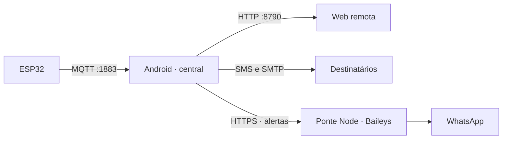

# Winterhold

**[Baixar APK Android diretamente](https://raw.githubusercontent.com/ThHSzR/winterhold/main/dist/winterhold-demo-debug.apk)** · [Instalação e execução](android/README.md)

O Android é a central: recebe ESP32 por MQTT, avalia faixas por ambiente, mantém histórico e alertas e serve a interface web em `http://IP_DO_CELULAR:8790/`. O navegador usa o mesmo estado e oferece os ajustes do aplicativo. **Somente a gestão de usuários e chaves de acesso web fica no celular.** Sem ESP conectado, ative a demonstração no app ou na web; ela oferece cinco ambientes fictícios independentes, leituras ajustáveis e testes explícitos de notificação.

O ESP publica `winterhold/<DEVICE_ID>/leituras` em MQTT 3.1.1 com usuário `winterhold` e chave gerada no aparelho. Cada ambiente físico tem nome, ícone, favorito e faixas mínimas e máximas de temperatura, umidade e tensão. A central guarda até 60 leituras por ESP (32 ambientes) e 500 eventos. A web exibe só a saúde do próprio celular; não consulta outros serviços do homelab. Veja [firmware e payload](backend/README.md).

## Começar

1. Instale o [APK](https://raw.githubusercontent.com/ThHSzR/winterhold/main/dist/winterhold-demo-debug.apk) no Android 8+. Abra o aplicativo e conceda notificações e operação contínua quando necessário.
2. Em **Ajustes → Usuários de acesso web**, copie a chave do administrador ou crie uma chave por pessoa. Abra o endereço indicado em **Ajustes → Web no celular** a partir da mesma rede e informe sua chave.
3. Em **Ajustes → ESP32 / MQTT** (app ou web), copie a chave MQTT. Configure o IP do celular, credenciais e `DEVICE_ID` em `backend/include/config.h`; grave o firmware. Em **Ambientes**, configure as faixas e fixe favoritos.
4. Para conhecer a interface sem sensores, ative **Ajustes → Demonstração**. Em **Ambientes**, selecione um dos cinco espaços, ajuste uma leitura fictícia e edite as faixas. **Alertas → Testar notificações** pode enviar SMS, e-mail e WhatsApp reais aos destinos que você configurar; eventos fictícios automáticos não enviam mensagens.

A rede local usa HTTP sem criptografia. Para acesso fora dela, use VPN ou proxy HTTPS. Credenciais de e-mail e da ponte WhatsApp são cifradas pelo Android Keystore e nunca retornam na API; a chave MQTT aparece nos ajustes web para usuários autenticados. Rotacione ou desative as chaves web pelo celular.

## Notificações

O aplicativo envia SMS pelo SIM, e-mail por SMTP TLS implícito na porta 465 e WhatsApp por uma [ponte Node com Baileys](backend/whatsapp/README.md). A ponte é **opcional e separada**: o APK continua sendo a única central e a única interface web remota, mas um processo Node precisa estar disponível para WhatsApp. Não depende de Termux nem de token Meta. É uma integração não oficial do WhatsApp; requer pareamento por QR e pode mudar com o protocolo. Os envios são reservados antes da chamada externa e não são repetidos automaticamente; `submitted` não comprova entrega no aparelho do destinatário. Veja o [guia Android](android/README.md).

O histórico é um arquivo privado atômico do app. Limpar dados ou desinstalar apaga histórico e configurações. A medição AC requer calibração e validação elétrica supervisionada antes de ser considerada confiável. Não há comando infravermelho para ligar ou desligar o ar-condicionado.
