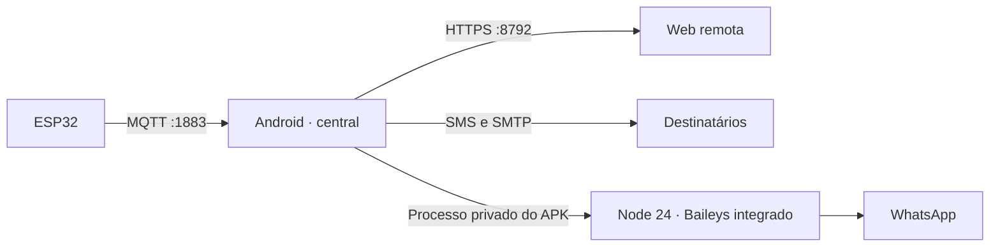

# Winterhold

**[Baixar APK Android diretamente](https://raw.githubusercontent.com/ThHSzR/winterhold/main/dist/winterhold-demo-debug.apk)** · [Instalação e execução](android/README.md)

O Android é a central: recebe ESP32 por MQTT, avalia faixas por ambiente, mantém histórico e alertas e serve a interface web em `https://IP_DO_CELULAR:8792/`. O navegador usa o mesmo estado e oferece os ajustes do aplicativo. **Somente a gestão de usuários, senhas e sessões web fica no celular.** Sem ESP conectado, ative a demonstração no app ou na web; ela oferece cinco ambientes fictícios independentes, leituras ajustáveis e testes explícitos de notificação.

O ESP publica `winterhold/<DEVICE_ID>/leituras` em MQTT 3.1.1 com usuário `winterhold` e chave gerada no aparelho. Cada ambiente físico tem nome, ícone, favorito e faixas mínimas e máximas de temperatura, umidade e tensão. A central guarda até 60 leituras por ESP (32 ambientes) e 500 eventos. A web exibe só a saúde do próprio celular; não consulta outros serviços do homelab. Veja [firmware e payload](backend/README.md).

## Começar

1. Instale o [APK](https://raw.githubusercontent.com/ThHSzR/winterhold/main/dist/winterhold-demo-debug.apk) no Android 8+. Abra o aplicativo e conceda notificações e operação contínua quando necessário.
2. Em **Ajustes → Usuários de acesso web**, anote a senha inicial ou defina uma nova e crie um login por pessoa. Abra o endereço HTTPS indicado, confira a impressão SHA-256 do certificado com o APK e entre com usuário e senha. Gestão de contas e revogação de sessões existem apenas no APK.
3. Em **Ajustes → ESP32 / MQTT** (app ou web), copie a chave MQTT. Configure o IP do celular, credenciais e `DEVICE_ID` em `backend/include/config.h`; grave o firmware. Em **Ambientes**, configure as faixas e fixe favoritos.
4. Para conhecer a interface sem sensores, ative **Ajustes → Demonstração**. Em **Ambientes**, selecione um dos cinco espaços, ajuste uma leitura fictícia e edite as faixas. Violações e normalizações enviam automaticamente SMS, e-mail e WhatsApp reais conforme destinos, métricas e canais. A ativação exige confirmação; mensagens levam `[SIMULADO]`. **Testar notificações** continua como ensaio explícito `[TESTE SIMULADO]`.

A web usa HTTPS com certificado local e chave privada no Android Keystore (porta 8792). Confira o SHA-256 mostrado no APK antes de confiar no certificado. HTTP 8790 rejeita autenticação e API pela LAN; localhost via ADB é permitido para diagnóstico. Para acesso externo, prefira VPN. Credenciais de e-mail e da ponte WhatsApp são cifradas pelo Android Keystore e nunca retornam na API; a chave MQTT aparece nos ajustes web para usuários autenticados. Redefina senhas, desative contas ou revogue sessões pelo celular.

## Notificações

O aplicativo envia SMS pelo SIM, e-mail por SMTP TLS na porta 465 e WhatsApp pelo Node/Baileys **incluído no APK ARM64**. O APK extrai os módulos privados, inicia e supervisiona o processo e preserva a sessão. Não requer Termux, PM2 ou instalação manual de Node. O QR aparece em Ajustes no APK e na web autenticada; use **Novo pareamento** para substituir uma sessão. Uma ponte HTTPS externa continua disponível como alternativa em outras ABIs. É uma integração não oficial e pode exigir atualização do APK quando o protocolo mudar. Os envios são reservados antes da chamada externa e não são repetidos automaticamente; `submitted` comprova submissão ao provedor, sem garantir entrega final. Veja [a implementação e validação da issue #2](docs/ISSUE_2.md).

O histórico é um arquivo privado atômico do app. Limpar dados ou desinstalar apaga histórico e configurações. A medição AC requer calibração e validação elétrica supervisionada antes de ser considerada confiável. Não há comando infravermelho para ligar ou desligar o ar-condicionado.
