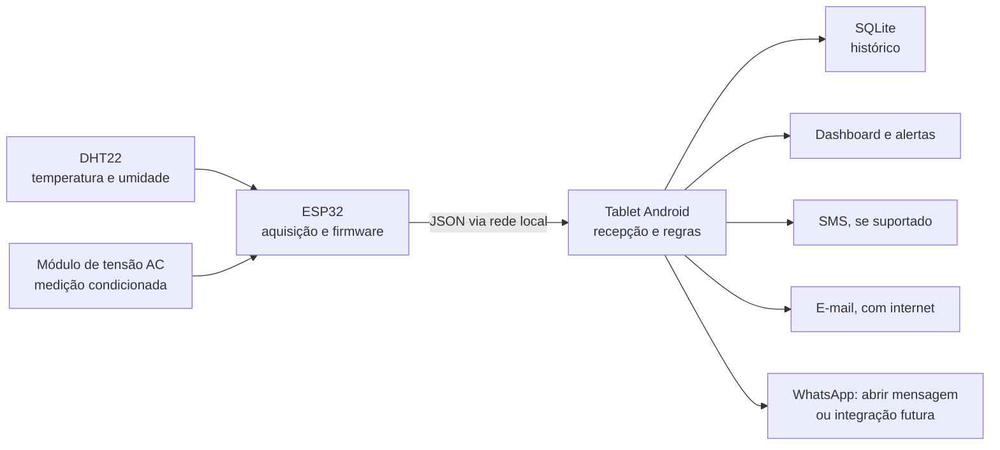

# Winterhold

Sistema embarcado para **monitoramento de ambientes climatizados**. Um ESP32 coleta temperatura, umidade relativa e tensão elétrica; um aplicativo Android recebe as medições, mantém um histórico local, mostra o estado do ambiente e gera alertas conforme regras configuradas.

> **Estado do projeto:** especificação e planejamento. Este repositório ainda não contém firmware, aplicativo ou montagem validada. Os exemplos abaixo são propostas de interface para orientar a implementação.

## Objetivo

O projeto nasceu de um caso de congelamento recorrente da serpentina e desligamentos inesperados de um ar-condicionado. A proposta é detectar condições anormais e avisar a equipe responsável antes que uma falha passe despercebida. O público previsto inclui manutenção, equipe elétrica e gestores de instalações.

Nesta primeira versão, **automação** significa coleta, análise, registro e disparo de alertas. O projeto de referência não especifica relé, contato seco ou interface homologada para comandar o equipamento; portanto, **ligar/desligar o ar-condicionado não faz parte da V1**. Qualquer controle físico futuro exigirá projeto elétrico, intertravamentos e validação específica do aparelho.

## Arquitetura prevista



O ESP32 e o tablet devem compartilhar uma rede local: ponto de acesso do tablet ou rede da instalação. O aplicativo Android é a central de processamento e pode usar a conexão móvel do tablet para os canais que dependem de internet. Queda do Wi-Fi local impede novas leituras mesmo que o chip SIM continue conectado.

| Camada | Responsabilidade proposta |
| --- | --- |
| ESP32 | Ler sensores, validar amostras e enviar leituras identificadas e com horário. |
| DHT22 | Medir temperatura e umidade no local definido para o protótipo. |
| Medição AC | Amostrar a saída condicionada do módulo, calibrar e estimar tensão RMS. |
| Android | Receber medições, armazenar em SQLite, avaliar regras e apresentar dashboard. |
| Notificações | Roteamento de eventos por destinatário, tipo de variável e canal. |

## Escopo da V1

- Aquisição de temperatura, umidade e tensão pelo ESP32.
- Envio periódico das leituras para um endpoint local no tablet.
- Persistência e visualização do histórico no Android.
- Regras configuráveis para temperatura alta, umidade alta, subtensão, sobretensão e ausência de leituras.
- Perfil de contatos por variável monitorada e canal de aviso.
- Registro de eventos, tentativas de envio, recuperação e falhas de comunicação.

Os valores de exemplo do documento (26 °C, 70% e tensão fora de ±10% da nominal) **não são limites universais**. Serão configurados e validados para o ambiente real, com histerese, tempo mínimo de violação e intervalo entre alertas para evitar notificações repetidas. O congelamento da serpentina não pode ser diagnosticado de forma conclusiva apenas com essas três grandezas; a posição dos sensores e os critérios de detecção precisam de ensaios.

### Contrato de dados inicial (proposta)

```http
POST /api/v1/leituras HTTP/1.1
Content-Type: application/json
```

```json
{
  "device_id": "sala-01",
  "timestamp": "2026-10-14T13:00:00Z",
  "temperatura_c": 24.5,
  "umidade_pct": 58.0,
  "tensao_rms_v": 220.4
}
```

Os nomes dos campos, autenticação, frequência de envio e política de reenvio serão fechados junto com o firmware e o aplicativo. O horário é ilustrativo; o formato UTC é a convenção proposta. O endpoint local da especificação usa a porta `8080`, sujeita a configuração na implementação.

## Notificações: critérios de implementação

| Canal | Comportamento previsto | Dependência |
| --- | --- | --- |
| Alerta no aplicativo | Exibir evento e manter histórico local. | Tablet operacional. |
| SMS | Envio pelo modem do tablet após teste de compatibilidade e permissões. | Tablet com suporte a SMS, SIM/plano e permissão Android. |
| E-mail | Envio por integração autenticada executada fora da interface principal. | Internet e provedor configurado. |
| WhatsApp por link | Abrir conversa com texto preenchido para confirmação de envio. | WhatsApp e ação do usuário. |
| WhatsApp automático | Estudar a plataforma oficial e seus requisitos numa etapa posterior. | Integração aprovada e conectividade. |

Abrir um link `wa.me` **não envia a mensagem automaticamente**. O envio automático, se necessário, será tratado como integração distinta. O envio de SMS também não é presumido só pela presença de entrada para SIM: é preciso verificar o hardware, o plano, as permissões e as restrições de distribuição do aplicativo. Não colocar credenciais SMTP, números pessoais ou tokens no repositório.

## Hardware previsto e decisões pendentes

| Item | Quantidade | Estimativa do documento |
| --- | ---: | ---: |
| ESP32 Wi-Fi/Bluetooth com USB-C | 1 | R$ 40–70 |
| Módulo de tensão AC ZMPT101B | 1 | R$ 25–45 |
| Sensor DHT22 | 1 | R$ 22–40 |
| Regulador LM2596 | 1 | R$ 15–25 |
| Power bank 10.000 mAh e dissipador | 1 | R$ 60–120 |
| Tablet Android com chip SIM | 1 | R$ 200–400 |
| Cabo blindado de três vias (20 m) | 20 m | R$ 30–50 |
| Cabos e jumpers | 1 kit | R$ 35–60 |
| Mão de obra/desenvolvimento | 5 serviços | R$ 2.500 |

Somando os preços **por item** do documento: hardware entre **R$ 427 e R$ 810**; com os R$ 2.500 de desenvolvimento, **R$ 2.927 a R$ 3.310**. O total impresso no documento (R$ 3.149 a R$ 3.755) não corresponde à soma da própria tabela. Os números são estimativas fornecidas no projeto, sem cotação atual, frete, plano móvel ou peças adicionais.

Antes da compra e montagem, validar:

- **Alimentação:** definir se a entrada será USB 5 V, bateria/power bank ou outra fonte. Confirmar a necessidade e a posição do LM2596; não presumir que ele estabiliza uma alimentação USB já regulada.
- **DHT22 a 20 m:** verificar a confiabilidade do barramento na distância real. O cabo blindado e o resistor pull-up previstos não garantem a operação; se os ensaios falharem, aproximar o ESP32 do sensor ou escolher outra interface.
- **Tensão AC:** definir ponto de medição, proteção, isolamento, fusível, invólucro, aterramento e calibração antes de ligar qualquer módulo à rede. A ligação à rede deve ser projetada e executada por profissional habilitado. O ADC do ESP32 deve receber apenas sinal condicionado dentro da faixa permitida.
- **Tablet:** confirmar suporte a SMS, estabilidade do servidor local em segundo plano, alimentação contínua e comportamento do hotspot após reinício.
- **Instalação:** posicionar o sensor para medir o ambiente de interesse e documentar acesso para manutenção, inclusive quando a sala estiver trancada.

## Plano de implementação

1. **Bancada:** definir alimentação, pinagem, sensores e ensaios seguros com a medição AC isolada.
2. **Firmware:** leituras, calibração, validação, identificação do dispositivo, conectividade e reenvio com limites de fila.
3. **App Android:** endpoint local, armazenamento, dashboard e regras de alerta.
4. **Canais e perfis:** contatos, filtros, confirmação de envio, deduplicação e registro de falhas.
5. **Integração:** testar perda de Wi-Fi, queda de energia, reinício do tablet, sensor desconectado e recuperação.
6. **Piloto:** medir estabilidade e ajustar limiares no ambiente de instalação antes de considerar qualquer comando do ar-condicionado.

### Critérios de aceite da V1

- Leituras identificadas aparecem no dashboard e no histórico, com indicação do horário da última amostra.
- Valores inválidos e dispositivo sem comunicação produzem estado explícito, sem aparentar operação normal.
- Um limite violado gera um evento rastreável; permanência na condição não causa envio em massa.
- O retorno à faixa normal é registrado, e falhas de entrega dos canais são visíveis.
- A medição de tensão é comparada com instrumento de referência em ensaio supervisionado.

## Organização prevista do repositório

```text
winterhold/
├── firmware/          # ESP32
├── android/           # aplicativo central
├── hardware/          # esquemas, lista de materiais e ensaios
├── docs/              # protocolo, arquitetura e validação
└── README.md
```

Esta árvore é uma proposta, ainda não criada.

## Equipe e referência

Projeto de Marini Luzia, Mateus Afonso, Nicole Noleto, Thiago Henrique e Ronaldo. O escopo inicial foi baseado no documento [**“Projeto de Sistema Embarcado - Automação e Monitoramento de Ar-Condicionado”**](docs/Projeto_de_Sistema_Embarcado.pdf), fornecido pela equipe.

Referências técnicas para as decisões de comunicação:

- [Android Developers: `SmsManager`](https://developer.android.com/reference/android/telephony/SmsManager) e [permissões em tempo de execução](https://developer.android.com/training/permissions/requesting).
- [WhatsApp: links para iniciar conversa](https://faq.whatsapp.com/5913398998672934).
- [Meta: WhatsApp Business Platform](https://developers.facebook.com/documentation/business-messaging/whatsapp/about-the-platform).
