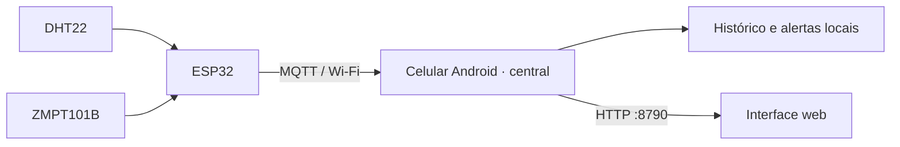

# Winterhold

**[Baixar APK Android diretamente](https://raw.githubusercontent.com/ThHSzR/winterhold/main/dist/winterhold-demo-debug.apk)** · [Instalação e execução](android/README.md)

O celular Android é a central do Winterhold. Ele recebe medições de ESP32 por MQTT, salva o histórico e os eventos localmente, avalia limiares e serve a mesma interface pela web na rede local. A tela do aplicativo e o navegador usam o mesmo estado. Há um modo demo com dados fictícios para explorar o visual sem sensores.

## Arquitetura



O firmware publica `winterhold/<DEVICE_ID>/leituras` em MQTT 3.1.1, QoS 0, a cada segundo. A central escuta publicadores na porta `1883` com usuário `winterhold` e chave gerada no aparelho. No aplicativo, **Ajustes → ESP32 / MQTT** mostra essa chave; ela não aparece na API web. Configure o IP do celular e a chave em `backend/include/config.h` antes de compilar o ESP32. Use uma rede local confiável. Detalhes do firmware: [backend/README.md](backend/README.md).

```json
{
  "device_id": "sala-01",
  "timestamp": "2026-10-20T13:00:00Z",
  "temperatura_c": 24.5,
  "umidade_pct": 58.0,
  "tensao_rms_v": null
}
```

O campo `timestamp` pode ser nulo quando o ESP não sincronizou o horário. A central usa o horário de recebimento do celular. Cada medição pode ser nula quando inválida; o módulo de tensão publica `null` até ser calibrado. A central mantém até 60 leituras por dispositivo identificado (máximo 32 ambientes) e 500 eventos ao salvar o estado.

## Vários ambientes

Cada ESP tem um `DEVICE_ID` único e corresponde a um ambiente físico. Em **Ajustes → ESP32 / MQTT → Adicionar ambiente**, cadastre esse ID, um nome como “Laboratório 02”, escolha um dos ícones e configure mínimos e máximos de temperatura, umidade e tensão. Também é possível editar um ESP detectado automaticamente. O aplicativo e a web compartilham esses cadastros e permitem selecionar a sala exibida; eventos indicam de qual ambiente vieram. Cada nova amostra é comparada apenas com a faixa do seu ambiente, e uma perda de sinal por mais de 15 segundos gera evento para o ESP correspondente. Alterações de limites só afetam leituras futuras. Configurações e leituras da versão anterior são migradas ao atualizar o aplicativo.

## Executar

1. [Baixe o APK](https://raw.githubusercontent.com/ThHSzR/winterhold/main/dist/winterhold-demo-debug.apk) e instale no Android 8 ou superior. É um build de debug; uma instalação anterior com assinatura diferente pode precisar ser removida, o que apaga os dados locais.
2. Abra o app e autorize a operação em segundo plano solicitada pelo Android. Em **Ajustes**, copie o endereço `http://IP_DO_CELULAR:8790/` e abra em outro dispositivo da mesma rede. Não é necessário Termux, PM2 ou homelab para a central Android.
3. Para dados reais, em **Ajustes → ESP32 / MQTT** copie a chave, cadastre os ambientes com os mesmos IDs definidos em cada ESP, configure e grave o [firmware](backend/README.md), depois ative **Mostrar leituras reais**. Sem ESP32, continue em modo demo.

A web local acadêmica usa HTTP sem login e aceita ações de ajuste; restrinja a rede a pessoas de confiança. Nenhum dado é puxado dos demais serviços do homelab. A saúde mostrada pela web é medida no celular Android. A prévia Node em [`web/`](web/README.md) é independente e usa dados fictícios.

## Estado e limites

- Recepção MQTT, histórico local persistido e eventos de limiar e comunicação funcionam na central Android. O ESP32 não reenvia amostras perdidas durante desconexão.
- Perfis SMS, e-mail e WhatsApp ainda são uma **prévia visual de roteamento**: nenhuma mensagem externa é enviada. Não há comando de ligar ou desligar o ar-condicionado.
- A medição AC exige calibração e validação elétrica supervisionada antes de ser considerada confiável. O sensor DHT22 é lido a cada dois segundos e pode repetir valor nas publicações de um segundo.
- O histórico usa arquivo privado atômico no aplicativo, sem SQLite. Limpar dados ou desinstalar apaga leituras e configurações.

Veja o [guia Android](android/README.md), o [guia web](web/README.md) e a [documentação do projeto](docs/).
