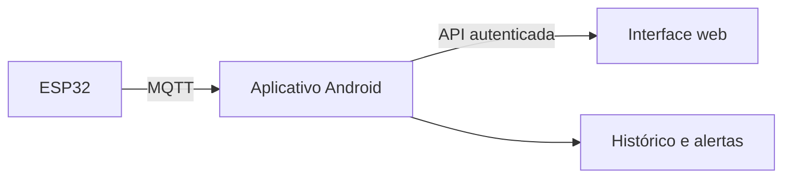

# Interface web e central Android

A branch `APK` contém demos em `web/` e `android/`. A interface web segue a navegação do APK: Início, Histórico, Alertas, Equipe e Ajustes. Leituras, eventos, contatos e saúde do celular exibidos na web são fictícios e vivem somente na memória do navegador. As duas demos não compartilham estado nesta etapa.

## Arquitetura prevista

O aplicativo no celular será a central: validará leituras, executará regras, persistirá histórico, registrará eventos e entregará avisos. A web consultará a central e indicará falhas de comunicação. O homelab é somente o ambiente de execução da interface web; não é uma fonte de dados sobre outros serviços. O broker MQTT não será acessado pelo navegador.

| Tela | Demonstração | Próxima integração |
| --- | --- | --- |
| Início | Temperatura, umidade, tensão, ESP32 e eventos como no APK; cartão de saúde fictícia do celular. | Leituras e saúde do Android, disponibilizadas pelo aplicativo. |
| Histórico | Gráfico e amostras geradas no navegador. | Consulta ao histórico persistido pelo celular. |
| Alertas | Eventos fictícios, filtro, resolução e prévia de rotas. | Eventos e tentativas de entrega da central. |
| Equipe | Perfis locais de manutenção, elétrica e gestão. | Destinatários e filtros autorizados na central. |
| Ajustes | Simulação, limiares e canais SMS, e-mail e WhatsApp. | Configurações persistidas no aplicativo. |

As rotas `GET /api/v1/status`, `/api/v1/leituras`, `/api/v1/eventos` e `/api/v1/contatos`, com atualização por SSE ou WebSocket, são propostas para a etapa seguinte. Um estado de saúde do próprio celular também poderá ser exposto. Ainda não existem. A autenticação, HTTPS, retenção e tratamento offline serão definidos antes de conectar dados reais. Serviços do homelab ficam fora do escopo.

Execute `cd web && npm test` e `npm start`. O [guia de execução](../web/README.md) explica o uso opcional do PM2 em Termux. Após atualizar a branch no celular, confira a interface revisada no navegador.
