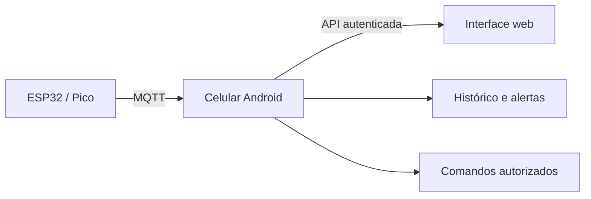

# Interface web e central Android

A branch `APK` contém demos em `web/` e `android/`. Leituras, eventos, contatos e estados da web são fictícios e vivem somente na memória do navegador. Nenhum ESP, broker, serviço ou atuador está conectado nesta etapa.

## Arquitetura prevista

O celular será responsável por validar leituras, executar regras, persistir histórico, registrar incidentes e entregar avisos. A web consultará a central e indicará falhas de comunicação. O broker MQTT não será acessado pelo navegador.

| Tela | Demonstração | Próxima integração |
| --- | --- | --- |
| Visão geral / Histórico | Temperatura, umidade e tensão fictícias. | Dados e histórico no celular. |
| Ambiente | Presença, porta, luz, agenda, relé e ar-condicionado ilustrativos. | Sensores e controle autorizado após validação do hardware. |
| Infraestrutura | Bateria, CPU, RAM, armazenamento, internet, energia, MQTT, Cloudflare, Tailscale/SSH, Playit e Minecraft de exemplo. | Coletores e sondagens reais no homelab. |
| Automações | Presença/agenda, economia, watchdog, energia e Wake-on-LAN apenas descritos. | Regras, histerese, transições e testes de recuperação. |
| Alertas / Equipe / Ajustes | Eventos e roteamento local para SMS, e-mail, WhatsApp, Telegram e Android. | Contatos, autorização, envio e confirmação de entrega. |

As rotas `GET /api/v1/status`, `/api/v1/leituras`, `/api/v1/eventos` e `/api/v1/contatos`, com atualização por SSE ou WebSocket, são propostas para a etapa seguinte. Ainda não existem. A autenticação, HTTPS, retenção, tratamento offline e autorização de comandos serão definidos antes de conectar dados reais.

Execute `cd web && npm test` e `npm start`. O [guia de execução](../web/README.md) explica o uso do PM2 em Termux. A validação no homelab e no navegador do celular ainda depende de acesso ao dispositivo.
