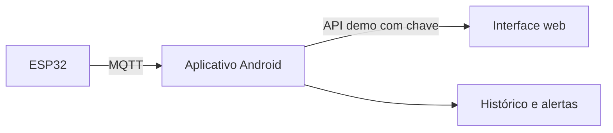

# Interface web e central Android

A branch `APK` contém a interface web embutida no aplicativo Android. A web segue a navegação do APK: Início, Histórico, Alertas, Equipe e Ajustes. Ao ser acessada pelo endereço mostrado no app, ela consulta o mesmo estado demo do Android e envia as ações de simulação para ele. Leituras, eventos e contatos são fictícios; a saúde do celular é medida pelo Android.

## Arquitetura prevista

O aplicativo no celular já é a central da **demo compartilhada**. No futuro, validará leituras MQTT, executará regras, persistirá histórico, registrará eventos e entregará avisos. O homelab não é fonte de dados sobre outros serviços. O broker MQTT não será acessado pelo navegador.

| Tela | Demonstração | Próxima integração |
| --- | --- | --- |
| Início | Temperatura, umidade, tensão, ESP32 e eventos do estado demo do APK; bateria, memória, armazenamento e tempo ligado medidos no Android. | Leituras reais do ESP32. |
| Histórico | Amostras demo do APK na web. | Consulta ao histórico persistido pelo celular. |
| Alertas | Eventos fictícios compartilhados, filtro, resolução e prévia de rotas. | Eventos e tentativas de entrega da central. |
| Equipe | Perfis de manutenção, elétrica e gestão compartilhados com o APK. | Destinatários e filtros persistidos. |
| Ajustes | Simulação, limiares e canais SMS, e-mail e WhatsApp sincronizados na demo. | Configurações persistidas no aplicativo. |

O APK serve a página e as rotas demo `GET /api/v1/state` e `POST /api/v1/action` na porta `8790`. Uma chave temporária exibida em Ajustes é exigida para a API. A web consulta o estado a cada cinco segundos. Esta solução HTTP é limitada à rede privada e ao tempo de vida do processo Android; um serviço persistente, HTTPS, retenção e autenticação durável serão definidos antes de dados reais. Serviços do homelab ficam fora do escopo.

Execute `cd web && npm test` para testar a prévia Node. O [guia de execução](../web/README.md) explica o acesso servido pelo APK e a prévia independente. Após instalar o novo APK no celular, confira a página e uma ação sincronizada em dois dispositivos.
